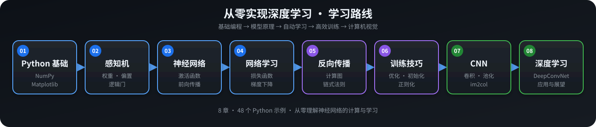

# 深度学习入门：从零开始实现神经网络

这是我学习《深度学习入门：基于 Python 的理论与实现》时建立的个人学习仓库。

项目没有使用 PyTorch、TensorFlow 等深度学习框架，而是以 Python 和 NumPy 为基础，从感知机开始，逐步实现神经网络的前向传播、梯度下降、误差反向传播、各种训练技巧、卷积神经网络以及更深的 CNN。

目前教材全部8章的学习、示例代码和总结笔记均已完成。



## 项目内容

- 8个章节的完整学习代码；
- 48个 Python 示例程序；
- 8份中文章节总结笔记；
- 67张用于辅助理解的笔记配图；
- 手写实现常用激活函数、损失函数、梯度、网络层和优化器；
- 实现两层全连接神经网络、SimpleConvNet 和 DeepConvNet；
- 包含数值梯度与反向传播的梯度检查；
- 包含训练后的 CNN 参数，可直接用于推理和可视化实验。

## 学习路线

```text
Python / NumPy / Matplotlib
            ↓
感知机与逻辑门
            ↓
神经网络与前向传播
            ↓
损失函数、数值微分与梯度下降
            ↓
计算图与误差反向传播
            ↓
优化器、初始化、正则化与超参数
            ↓
卷积层、池化层与 CNN
            ↓
DeepConvNet 与深度学习应用
```

## 章节导航

| 章节 | 主要内容 | 示例代码 | 总结笔记 |
|---|---|---|---|
| 第1章 Python 入门 | Python、NumPy、Matplotlib 和图像显示 | [`ch01/`](ch01/) | [第一章笔记](docs/ch01.md) |
| 第2章 感知机 | 感知机、决策边界、AND/NAND/OR/XOR | [`ch02/`](ch02/) | [第二章笔记](docs/ch02.md) |
| 第3章 神经网络 | 激活函数、矩阵传播、Softmax、MNIST 推理与批处理 | [`ch03/`](ch03/) | [第三章笔记](docs/ch03.md) |
| 第4章 神经网络的学习 | 损失函数、mini-batch、数值梯度和梯度下降 | [`ch04/`](ch04/) | [第四章笔记](docs/ch04.md) |
| 第5章 误差反向传播法 | 计算图、链式法则、各层反向传播和梯度检查 | [`ch05/`](ch05/) | [第五章笔记](docs/ch05.md) |
| 第6章 与学习相关的技巧 | 优化器、初始化、BatchNorm、Dropout、权值衰减和超参数 | [`ch06/`](ch06/) | [第六章笔记](docs/ch06.md) |
| 第7章 卷积神经网络 | 卷积、池化、`im2col`、SimpleConvNet 和滤波器可视化 | [`ch07/`](ch07/) | [第七章笔记](docs/ch07.md) |
| 第8章 深度学习 | DeepConvNet、经典网络、高速化和应用案例 | [`ch08/`](ch08/) | [第八章笔记](docs/ch08.md) |

## 核心实现

### 基础函数

[`common/functions.py`](common/functions.py) 中实现了：

- Sigmoid；
- ReLU；
- Softmax；
- 均方误差；
- 交叉熵误差。

### 网络层

[`common/layers.py`](common/layers.py) 中实现了：

- `MulLayer`、`AddLayer`；
- `Relu`、`Sigmoid`；
- `Affine`；
- `SoftmaxWithLoss`；
- `Dropout`、`BatchNormalization`；
- `Convolution`、`Pooling`。

每一层都具有 `forward()` 和 `backward()`，因此可以像搭积木一样组合网络并进行反向传播。

### 优化器

[`common/optimizer.py`](common/optimizer.py) 中实现了：

- SGD；
- Momentum；
- Nesterov；
- AdaGrad；
- RMSprop；
- Adam。

### 网络与训练工具

- [`common/multi_layer_net.py`](common/multi_layer_net.py)：多层全连接网络；
- [`common/multi_layer_net_extend.py`](common/multi_layer_net_extend.py)：支持 Dropout 和 Batch Normalization 的扩展网络；
- [`common/trainer.py`](common/trainer.py)：mini-batch 抽取、参数更新和准确率评估；
- [`common/util.py`](common/util.py)：`im2col`、`col2im` 和其他辅助函数。

## 目录结构

```text
deep_learning_from_scratch/
├── ch01/ ... ch08/       # 各章示例代码
├── common/               # 函数、网络层、优化器和训练工具
├── dataset/              # MNIST 加载代码和示例图片
├── docs/
│   ├── ch01.md ... ch08.md
│   └── images/           # 笔记配图
├── .vscode/              # 本项目的 VS Code Python 配置
├── environment.yml       # Conda 环境说明
└── README.md
```

## 环境配置

项目使用的主要环境：

```text
Python      3.11
NumPy
Matplotlib
Pillow
```

Anaconda 和 Miniconda 都可以使用。本项目开发时使用 Miniconda。

### 创建环境

在仓库根目录执行：

```bash
conda env create -f environment.yml
conda activate dlfs
```

如果本机已经存在 `dlfs` 环境，可以根据环境文件更新：

```bash
conda env update -n dlfs -f environment.yml
conda activate dlfs
```

验证环境：

```bash
python --version
python -c "import numpy, matplotlib, PIL; print(numpy.__version__, matplotlib.__version__, PIL.__version__)"
```

## MNIST 数据集

第一次调用 `load_mnist()` 时，程序会自动下载 MNIST 原始压缩文件，并在 `dataset/` 中生成缓存文件：

```text
dataset/*.gz
dataset/mnist.pkl
```

这些下载文件已经加入 `.gitignore`，不会重复提交到 Git。首次运行需要能够访问数据下载地址。

MNIST 常见的数据形状：

```text
训练图像：       (60000, 784)
训练标签：       (60000,)
测试图像：       (10000, 784)
测试标签：       (10000,)

CNN 四维输入：   (N, 1, 28, 28)
one-hot 标签：   (N, 10)
```

## 运行示例

部分代码使用相对路径导入父目录模块或读取参数文件，因此推荐先进入对应章节目录再运行。

### 感知机与逻辑门

```bash
cd ch02
python xor_gate.py
```

### MNIST 推理

```bash
cd ch03
python neuralnet_mnist.py
python neuralnet_mnist_batch.py
```

### 反向传播梯度检查

```bash
cd ch05
python gradient_check.py
```

数值梯度与反向传播梯度之间的平均差应非常小。

### 比较优化器

```bash
cd ch06
python optimizer_compare_naive.py
python optimizer_compare_mnist.py
```

### SimpleConvNet 梯度检查与滤波器可视化

```bash
cd ch07
python gradient_check.py
python visualize_filter.py
python apply_filter.py
```

### DeepConvNet 推理实验

```bash
cd ch08
python half_float_network.py
python misclassified_mnist.py
```

当前保存的 `deep_convnet_params.pkl` 在完整 MNIST 测试集上的实测准确率为：

```text
accuracy = 0.9935
         = 99.35%
```

由于训练过程包含随机初始化和随机抽样，重新训练得到的结果可能略有不同。

## 训练时间说明

以下脚本计算量较大：

```text
ch07/train_convnet.py
ch08/train_deepnet.py
```

这个项目主要基于 NumPy，在 CPU 上训练 CNN 可能需要较长时间。仓库已经保存：

- `ch07/params.pkl`；
- `ch08/deep_convnet_params.pkl`。

如果只想进行推理、误分类分析或滤波器可视化，可以直接读取这些参数，不必重新训练。

绘图和图像显示脚本需要图形桌面环境；在没有图形界面的远程终端中运行时，可能需要改为保存图片而不是调用 `plt.show()`。

## 学习成果

完成这个项目后，我对下面这些内容建立了较完整的理解：

- 神经元如何通过权重、偏置和激活函数计算输出；
- 矩阵形状如何在神经网络中逐层变化；
- 损失函数为什么能为学习提供方向；
- 数值梯度、梯度下降和学习率分别起什么作用；
- 链式法则如何转化为高效的误差反向传播；
- 不同优化器、初始化和正则化方法如何影响训练；
- 卷积、池化、`im2col` 和 `col2im` 怎样实现；
- CNN 如何从局部特征逐渐学习更抽象的表示；
- 怎样通过梯度检查验证反向传播实现；
- 深层网络、高效计算和经典 CNN 结构之间的关系。

## 项目状态

```text
[完成] 第1章 Python 入门
[完成] 第2章 感知机
[完成] 第3章 神经网络
[完成] 第4章 神经网络的学习
[完成] 第5章 误差反向传播法
[完成] 第6章 与学习相关的技巧
[完成] 第7章 卷积神经网络
[完成] 第8章 深度学习
```

教材全部内容已学习完成，代码和笔记均已在本地 Git 仓库中按阶段存档。

## 说明

本仓库是个人学习与复习记录，重点在于理解原理和亲手实现，因此部分代码保留了教材式、便于观察计算过程的写法，而不以生产环境性能为目标。

教材、教材插图及参考实现的著作权归原作者和出版方所有。本仓库中的章节笔记为个人整理，仅用于学习交流；公开或传播教材 PDF 等资料时，请自行确认并遵守相应版权要求。
