# 第三章 神经网络

## 1. 本章核心

第三章从感知机过渡到神经网络，重点介绍神经网络如何把输入信号逐层转换为输出信号，也就是前向传播。

本章最重要的内容是：

- 神经网络由输入层、隐藏层和输出层组成；
- 神经元先计算加权和，再使用激活函数转换信号；
- 隐藏层必须使用非线性激活函数；
- 矩阵乘法可以一次完成一层中所有神经元的计算；
- 输出层的设计取决于问题类型；
- Softmax 可以把分类输出转换为概率；
- MNIST 推理展示了已训练神经网络的完整前向传播；
- 批处理可以一次计算多个样本，提高运算效率。

第三章只关注已经确定参数后的推理过程。如何自动学习权重和偏置，将从第四章开始介绍。

## 2. 从感知机到神经网络

### 2.1 网络的层

典型神经网络可以表示为：

```text
输入层（第 0 层） → 隐藏层（第 1 层） → 输出层（第 2 层）
```

- 输入层接收原始数据；
- 隐藏层对输入进行逐层转换；
- 输出层给出最终预测结果。

隐藏层也叫中间层。“隐藏”表示这一层的状态不像输入和正确答案那样可以直接观察到。

教材通常按照具有权重的连接层数来命名网络。因此，三列神经元之间有两组带权重的连接时，教材称其为“2 层网络”；其他资料也可能按神经元列数称其为“3 层网络”。

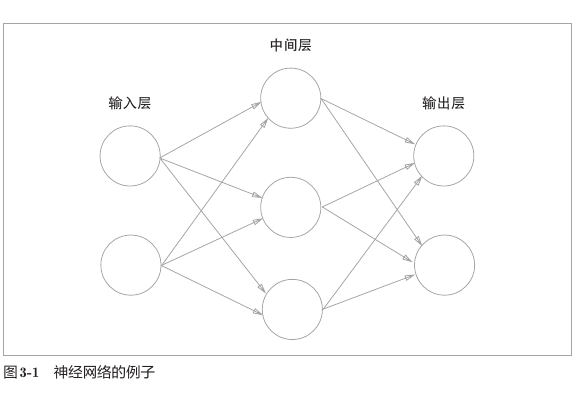

读网络结构图时，应当区分“节点”和“连接”：

- 圆形表示神经元或节点，保存这一层的信号；
- 箭头表示信号传递方向；
- 每条连接都有自己的权重；
- 相邻两层通常是全连接：前一层的每个节点都与后一层的每个节点相连。

图中有三列神经元，但只有两组带权重的连接，因此教材称它为“2 层网络”。

### 2.2 神经元的计算过程

接收两个输入的神经元先计算：

$$
a=b+w_1x_1+w_2x_2
$$

然后使用激活函数：

$$
y=h(a)
$$

合并后得到：

$$
y=h(b+w_1x_1+w_2x_2)
$$

其中：

- `x1、x2`：输入信号；
- `w1、w2`：权重，控制输入的重要程度；
- `b`：偏置，控制神经元被激活的难易程度；
- `a`：加权和；
- `h()`：激活函数；
- `y`：神经元的输出。

计算可以拆成两个阶段：

```text
输入信号 → 加权求和得到 a → 激活函数 h(a) → 输出 y
```

偏置也可以看作一个固定输入为 `1`、权重为 `b` 的特殊输入信号：

$$
b=b\times1
$$

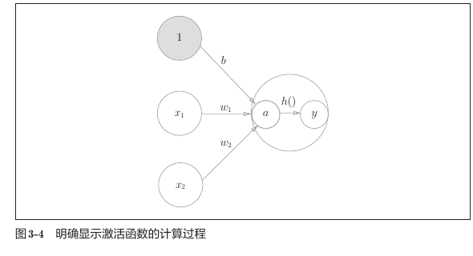

图中把一个神经元内部的计算明确拆成了两步：

```text
x1、x2 和常数 1
        ↓ 分别乘以 w1、w2、b 并相加
加权和 a = b + w1*x1 + w2*x2
        ↓ 经过激活函数 h()
输出 y = h(a)
```

`a` 和 `y` 不是同一个量：`a` 是激活前的加权和，`y` 是经过激活函数转换后的输出。后面的代码使用 `a1、a2、a3` 表示各层激活前的结果，使用 `z1、z2` 表示隐藏层激活后的结果。

## 3. 激活函数

激活函数决定如何把加权和 `a` 转换为输出 `y`。感知机与神经网络的主要区别之一就是使用的激活函数不同。

### 3.1 阶跃函数

阶跃函数在输入大于 `0` 时输出 `1`，否则输出 `0`：

$$
h(x)=
\begin{cases}
0, & x\leq0 \\
1, & x>0
\end{cases}
$$

现代 NumPy 写法：

```python
def step_function(x):
    return np.array(x > 0, dtype=np.int32)
```

示例：

```python
x = np.array([-1.0, 1.0, 2.0])
print(step_function(x))
```

输出：

```text
[0 1 1]
```

教材中的 `np.int` 已被新版 NumPy 删除，应改用 `int`、`np.int32` 或 `np.int64`。

### 3.2 Sigmoid 函数

Sigmoid 函数为：

$$
h(x)=\frac{1}{1+e^{-x}}
$$

实现：

```python
def sigmoid(x):
    return 1 / (1 + np.exp(-x))
```

示例：

```python
x = np.array([-1.0, 1.0, 2.0])
print(sigmoid(x))
```

输出约为：

```text
[0.26894142 0.73105858 0.88079708]
```

这个函数能够直接处理数组，是因为 `np.exp()` 会逐元素计算，而标量 `1` 会通过 NumPy 广播与数组的每个元素运算。

### 3.3 阶跃函数与 Sigmoid 的比较

不同点：

| 特征 | 阶跃函数 | Sigmoid |
| --- | --- | --- |
| 输出变化 | 在 `0` 处突然跳变 | 平滑、连续变化 |
| 输出类型 | 只有 `0` 或 `1` | `0～1` 之间的实数 |
| 信号表现 | 二值信号 | 连续信号 |

共同点：

- 输入较小时，输出接近 `0`；
- 输入较大时，输出接近 `1`；
- 输出范围都在 `0～1`；
- 都是非线性函数。

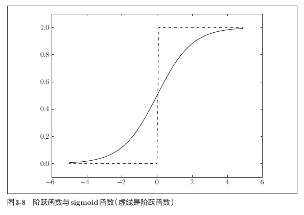

从图中可以直观看出：

```text
阶跃函数：输入跨过 0 时，输出突然从 0 跳到 1
Sigmoid：  输入改变时，输出平滑地从 0 过渡到 1
```

两者的大体形状相似，但 Sigmoid 能把输入强弱转换成连续信号。例如，`0.51` 和 `0.99` 都表示激活，但还能反映激活程度；阶跃函数只能输出 `0` 或 `1`。

### 3.4 ReLU 函数

ReLU 在输入大于 `0` 时直接输出输入值，否则输出 `0`：

$$
h(x)=
\begin{cases}
0, & x\leq0 \\
x, & x>0
\end{cases}
$$

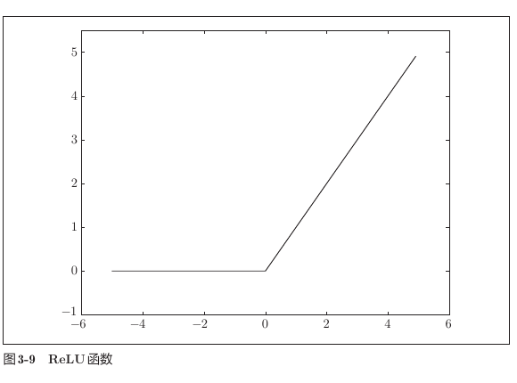

实现：

```python
def relu(x):
    return np.maximum(0, x)
```

示例：

```python
x = np.array([-2.0, 0.0, 3.0])
print(relu(x))
```

输出：

```text
[0. 0. 3.]
```

### 3.5 为什么必须使用非线性激活函数

如果隐藏层使用线性函数，例如：

$$
h(x)=cx
$$

连续叠加三层后：

$$
h(h(h(x)))=c^3x
$$

它仍然等价于一次线性运算：

$$
y=ax
$$

因此，无论叠加多少层，都不能增强模型的表达能力。使用非线性激活函数后，多层网络才能表示更复杂的非线性关系。

## 4. NumPy 多维数组

### 4.1 维数与形状

一维数组：

```python
A = np.array([1, 2, 3, 4])
print(np.ndim(A))
print(A.shape)
```

输出：

```text
1
(4,)
```

`(4,)` 表示一个只有一个元素的元组：数组只有一个维度，该维度长度为 `4`。`(4)` 只是整数 `4`，因此一维形状必须写出逗号。

二维数组：

```python
B = np.array([
    [1, 2],
    [3, 4],
    [5, 6],
])
print(np.ndim(B))
print(B.shape)
```

输出：

```text
2
(3, 2)
```

这表示 `3` 行、`2` 列。

### 4.2 矩阵乘法

矩阵乘法使用 `np.dot()`：

```python
A = np.array([[1, 2], [3, 4]])
B = np.array([[5, 6], [7, 8]])
print(np.dot(A, B))
```

输出：

```text
[[19 22]
 [43 50]]
```

需要区分：

```python
A * B          # 对应元素相乘
np.dot(A, B)   # 矩阵乘法
```

矩阵乘法通常不满足交换律：

```text
np.dot(A, B) 不一定等于 np.dot(B, A)
```

### 4.3 形状规则

如果：

```text
A.shape = (m, n)
B.shape = (n, p)
```

那么：

```text
np.dot(A, B).shape = (m, p)
```

关键规则：左矩阵的列数必须等于右矩阵的行数。

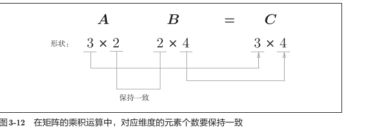

```text
(m, n) · (n, p) → (m, p)
     ↑     ↑
     必须相等
```

无法计算：

```text
(2, 3) · (2, 2)
```

可以计算：

```text
(2, 3) · (3, 2) → (2, 2)
```

### 4.4 矩阵乘法为什么能表示一层神经网络

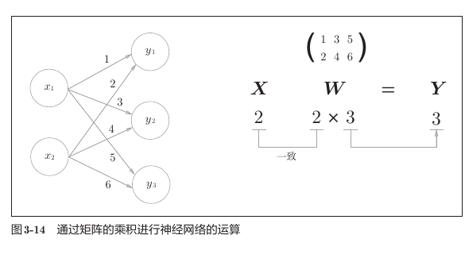

图中的输入和权重形状为：

```text
X: (2,)
W: (2, 3)
```

矩阵乘法：

```text
(2,) · (2, 3) → (3,)
```

输出 `Y` 中的三个元素，分别对应三个输出神经元。展开来看：

$$
\boldsymbol{W}=
\begin{pmatrix}
w_{11} & w_{21} & w_{31} \\
w_{12} & w_{22} & w_{32}
\end{pmatrix}
$$

$$
y_1=x_1w_{11}+x_2w_{12}
$$

$$
y_2=x_1w_{21}+x_2w_{22}
$$

$$
y_3=x_1w_{31}+x_2w_{32}
$$

这里沿用教材的权重下标约定：第一个下标表示后一层神经元，第二个下标表示前一层神经元。例如 $w_{12}$ 表示“前一层第2个神经元到后一层第1个神经元”的权重。NumPy 数组 `W` 为了配合 `X @ W`，则按“前一层节点、后一层节点”的顺序存放，其数组索引与数学下标的书写顺序不同，不要把两者机械地一一对应。

`np.dot(X, W)` 一次完成了三个神经元的加权和计算，不需要分别为每个神经元编写循环。这就是后面所有全连接层都使用矩阵乘法的原因。

## 5. 三层神经网络的前向传播

教材实现的网络结构是：

```text
输入层 2 个节点
    ↓ W1: (2, 3)
第 1 隐藏层 3 个节点
    ↓ W2: (3, 2)
第 2 隐藏层 2 个节点
    ↓ W3: (2, 2)
输出层 2 个节点
```

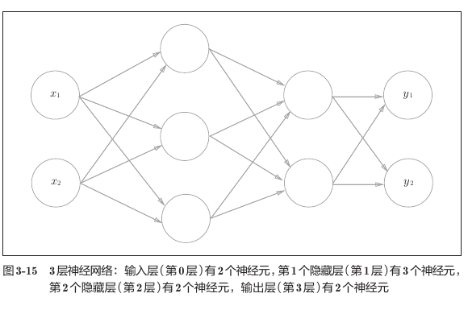

教材把具有权重的三组连接记作第1层、第2层和第3层，因此称为“3层神经网络”。信号沿箭头从左向右传播，这个从输入得到输出的过程叫作**前向传播**。

### 5.1 第一层

```python
a1 = np.dot(x, W1) + b1
z1 = sigmoid(a1)
```

形状变化：

```text
x:  (2,)
W1: (2, 3)
b1: (3,)
a1: (3,)
z1: (3,)
```

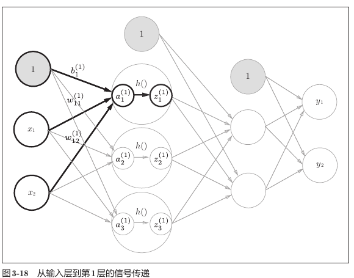

粗线表示第1层第1个神经元的计算：

$$
a_1^{(1)}=x_1w_{11}^{(1)}+x_2w_{12}^{(1)}+b_1^{(1)}
$$

对第1层的三个神经元同时计算，可以写成：

$$
\boldsymbol{A}^{(1)}=\boldsymbol{X}\boldsymbol{W}^{(1)}+\boldsymbol{B}^{(1)}
$$

然后逐元素应用 Sigmoid：

$$
\boldsymbol{Z}^{(1)}=\operatorname{sigmoid}(\boldsymbol{A}^{(1)})
$$

### 5.2 第二层

```python
a2 = np.dot(z1, W2) + b2
z2 = sigmoid(a2)
```

形状变化：

```text
z1: (3,)
W2: (3, 2)
b2: (2,)
a2: (2,)
z2: (2,)
```

### 5.3 输出层

```python
a3 = np.dot(z2, W3) + b3
y = identity_function(a3)
```

形状变化：

```text
z2: (2,)
W3: (2, 2)
b3: (2,)
a3: (2,)
y:  (2,)
```

恒等函数不改变输入：

```python
def identity_function(x):
    return x
```

### 5.4 完整处理

```python
def forward(network, x):
    W1, W2, W3 = network["W1"], network["W2"], network["W3"]
    b1, b2, b3 = network["b1"], network["b2"], network["b3"]

    a1 = np.dot(x, W1) + b1
    z1 = sigmoid(a1)
    a2 = np.dot(z1, W2) + b2
    z2 = sigmoid(a2)
    a3 = np.dot(z2, W3) + b3
    return identity_function(a3)
```

教材使用一维偏置时，输入：

```python
x = np.array([1.0, 0.5])
```

输出约为：

```text
[0.31682708 0.69627909]
```

当前 `three_layer_network.py` 已将偏置写成一维数组，因此输出形状与教材一致：

```text
b1: (3,)
b2: (2,)
b3: (2,)
y:  (2,)
```

完整的形状传递为：

```text
x (2,)
  ↓ · W1 (2,3) + b1 (3,)
a1 (3,) → sigmoid → z1 (3,)
  ↓ · W2 (3,2) + b2 (2,)
a2 (2,) → sigmoid → z2 (2,)
  ↓ · W3 (2,2) + b3 (2,)
a3 (2,) → identity → y (2,)
```

## 6. 输出层的设计

### 6.1 分类与回归

- 分类：判断输入属于哪个类别，例如识别图片中的数字；
- 回归：预测连续数值，例如根据图片预测体重。

常见输出层选择：

| 问题类型 | 输出层函数 |
| --- | --- |
| 回归 | 恒等函数 |
| 二元分类 | Sigmoid |
| 多元分类 | Softmax |

分类问题中，输出层神经元数量一般等于类别数量。MNIST 有数字 `0～9` 共 10 个类别，所以输出层有 10 个神经元。

### 6.2 Softmax 函数

第 `k` 个输出为：

$$
y_k=\frac{e^{a_k}}{\sum_{i=1}^{n}e^{a_i}}
$$

Softmax 的特点：

- 每个输出都在 `0～1` 之间；
- 所有输出之和为 `1`；
- 可以把输出解释为各类别的概率；
- 不改变各元素的大小顺序。

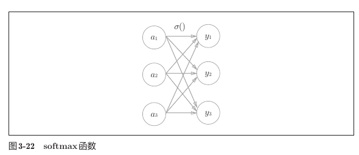

与 Sigmoid 逐元素计算不同，每个 Softmax 输出都需要使用全部输入，因为分母包含所有输入的指数之和：

```text
y1 同时依赖 a1、a2、a3
y2 同时依赖 a1、a2、a3
y3 同时依赖 a1、a2、a3
```

因此，Softmax 处理的是一整组类别得分之间的相对关系，而不是孤立地转换某一个元素。

示例：

```python
a = np.array([0.3, 2.9, 4.0])
print(softmax(a))
```

输出：

```text
[0.01821127 0.24519181 0.73659691]
```

表示三个类别的概率约为 `1.8%`、`24.5%` 和 `73.7%`，最大值的数组索引是 `2`，因此预测索引 `2` 对应的类别，也就是第三项。

### 6.3 防止指数溢出

直接计算较大的指数可能得到 `inf` 或 `nan`。Softmax 可以先减去输入最大值：

```python
def softmax(x):
    exp_x = np.exp(x - np.max(x))
    return exp_x / np.sum(exp_x)
```

示例：

```python
x = np.array([1010.0, 1000.0, 990.0])
print(softmax(x))
```

输出：

```text
[9.99954600e-01 4.53978686e-05 2.06106005e-09]
```

减去同一个常数不会改变 Softmax 的结果，却能避免指数过大。

### 6.4 推理时为什么可以省略 Softmax

指数函数单调递增，因此 Softmax 不会改变最大值所在的位置：

```text
Softmax 前最大元素的索引 = Softmax 后最大概率的索引
```

如果推理时只需要最终类别，可以直接使用 `np.argmax()` 找最大输出，省略 Softmax 以减少计算。训练阶段仍需要 Softmax 来配合损失函数。

## 7. MNIST 数据集

### 7.1 数据组成

MNIST 包含手写数字 `0～9`：

- 训练图像：60000 张；
- 测试图像：10000 张；
- 每张图像：`28 × 28` 灰度图；
- 每个像素：`0～255`；
- 每张图片都有正确数字标签。

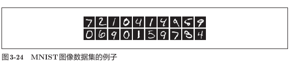

同一个数字可能有完全不同的书写方式。神经网络的任务不是记住某一种固定笔迹，而是从大量训练样本中提取能够区分数字的共同模式。

当前数据形状：

```text
x_train: (60000, 784)
t_train: (60000,)
x_test:  (10000, 784)
t_test:  (10000,)
```

### 7.2 `load_mnist()` 参数

```python
load_mnist(
    normalize=True,
    flatten=True,
    one_hot_label=False,
)
```

`normalize`：

- `False`：像素保持 `0～255`；
- `True`：像素除以 `255`，转换到 `0.0～1.0`。

这种对输入数据的转换称为预处理，其中把数据调整到特定范围称为正规化。

`flatten`：

- `True`：图像形状为 `(784,)`；
- `False`：图像形状为 `(1, 28, 28)`。

`one_hot_label`：

- `False`：标签直接保存为 `2`、`7` 等类别编号；
- `True`：标签保存为长度 10 的 one-hot 数组。

数字 `2` 的 one-hot 标签：

```text
[0, 0, 1, 0, 0, 0, 0, 0, 0, 0]
```

### 7.3 显示图像

展开后的图像需要还原形状：

```python
img = x_train[0]
print(img.shape)
img = img.reshape(28, 28)
print(img.shape)
```

输出：

```text
(784,)
(28, 28)
```

第一张训练图片的标签是：

```text
5
```

`reshape()` 只改变数组形状，不改变元素内容。

### 7.4 数据文件和权重文件的区别

- `dataset/mnist.pkl`：MNIST 图片与标签的本地缓存；
- `ch03/sample_weight.pkl`：作者预先训练好的网络参数。

`sample_weight.pkl` 中保存了：

```text
W1、W2、W3、b1、b2、b3
```

它通过 Pickle 读取：

```python
with open("sample_weight.pkl", "rb") as file:
    network = pickle.load(file)
```

- `pickle.load()` 把 Pickle 文件恢复为 Python 对象；
- `rb` 表示以二进制只读模式打开文件；
- 不应加载来源不可信的 Pickle 文件。

## 8. MNIST 神经网络推理

网络形状：

```text
输入 X:  (784,)
W1:      (784, 50)
隐藏层1: (50,)
W2:      (50, 100)
隐藏层2: (100,)
W3:      (100, 10)
输出 Y:  (10,)
```

每个输出元素对应数字 `0～9` 中的一个类别。

预测过程：

```python
y = predict(network, x[i])
p = np.argmax(y)
```

`np.argmax(y)` 返回最大输出值的索引，也就是预测的数字。

单张循环推理的验证结果：

```text
accuracy = 0.9352
```

表示 10000 张测试图片中约有 `93.52%` 被正确识别。

## 9. 批处理

### 9.1 什么是批

批是打包在一起的一组输入数据。单张输入形状为：

```text
(784,)
```

一次输入 100 张图片时：

```text
(100, 784)
```

经过网络后输出：

```text
(100, 10)
```

其中每一行对应一张图片的 10 个类别输出。

单张图片的形状传递：

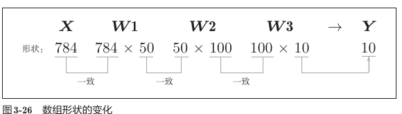

```text
X:  (784,)
W1: (784, 50)
W2: (50, 100)
W3: (100, 10)
Y:  (10,)
```

一次输入100张图片时，只在最前面增加批维度：

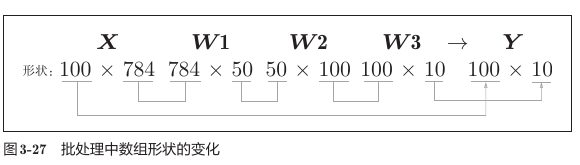

```text
X:  (100, 784)
W1: (784, 50)
W2: (50, 100)
W3: (100, 10)
Y:  (100, 10)
```

需要重点观察：权重的形状完全不变，批维度 `100` 会一路保留到输出。矩阵乘法的形状变化为：

```text
(100, 784) · (784, 50)  → (100, 50)
(100, 50)  · (50, 100)  → (100, 100)
(100, 100) · (100, 10)  → (100, 10)
```

输出 `Y` 的第 `i` 行就是输入 `X` 第 `i` 张图片的预测结果：

```text
X[0] ↔ Y[0]
X[1] ↔ Y[1]
...
X[99] ↔ Y[99]
```

### 9.2 批处理代码

```python
batch_size = 100

for i in range(0, len(x), batch_size):
    x_batch = x[i:i + batch_size]
    y_batch = predict(network, x_batch)
    p = np.argmax(y_batch, axis=1)
    accuracy_cnt += np.sum(p == t[i:i + batch_size])
```

关键点：

- `range(0, len(x), 100)` 每次索引增加 100；
- `x[i:i+100]` 取出一批图片；
- `axis=1` 表示在每一行的 10 个类别中寻找最大值；
- `p == t[...]` 生成布尔数组；
- `np.sum()` 把 `True` 当作 `1`，统计正确数量。

`argmax` 和准确率统计中的形状变化：

```text
y_batch:                     (100, 10)
np.argmax(y_batch, axis=1):  (100,)
t[i:i+100]:                  (100,)
p == t[i:i+100]:             (100,) 布尔数组
np.sum(...):                 标量（本批预测正确的数量）
```

这里的 `axis=1` 表示沿每一行的10个类别寻找最大值。如果写成 `axis=0`，就会在100张图片之间按列找最大值，得到10个结果，这并不是我们需要的“每张图片预测一个数字”。

批处理推理结果：

```text
accuracy = 0.9352
```

批处理不会改变预测逻辑和准确率，主要目的是提高计算效率。

## 10. 本章代码与结果

| 文件 | 作用 | 主要结果 |
| --- | --- | --- |
| `step_function.py` | 实现并绘制阶跃函数 | 在 `x=0` 处从 0 跳变到 1 |
| `sigmoid.py` | 实现并绘制 Sigmoid | 输出平滑变化于 0～1 |
| `sig_step_compare.py` | 比较阶跃函数与 Sigmoid | 显示两条激活函数曲线 |
| `relu.py` | 实现并绘制 ReLU | 负数输出 0，正数原样输出 |
| `softmax.py` | 实现稳定版 Softmax | 输出总和为 1 |
| `three_layer_network.py` | 实现三层网络前向传播 | 输出约为 `[0.3168, 0.6963]` |
| `mnist_show.py` | 读取并显示 MNIST 图片 | 第一张图片标签为 5 |
| `neuralnet_mnist.py` | 逐张进行 MNIST 推理 | 准确率 0.9352 |
| `neuralnet_mnist_batch.py` | 使用批处理进行推理 | 准确率 0.9352 |

## 11. 常见易错点

### 11.1 数组形状不匹配

矩阵乘法前先检查：

```python
print(x.shape)
print(W.shape)
```

只有相邻维度相等才能执行 `np.dot()`。

### 11.2 一维和二维数组混淆

```python
np.array([0.1, 0.2])      # shape: (2,)
np.array([[0.1, 0.2]])    # shape: (1, 2)
```

多写一层方括号会增加一个批维度，并通过广播影响后续输出形状。

### 11.3 `np.array()` 与 `np.arange()` 混淆

- `np.array([...])`：把已有数据创建为数组；
- `np.arange(start, stop, step)`：按范围和步长生成数组。

### 11.4 导入模块时意外执行绘图代码

可执行代码应放进：

```python
if __name__ == "__main__":
    main()
```

这样导入 `sigmoid()`、`relu()` 等函数时不会弹出绘图窗口。

### 11.5 相对路径依赖当前工作目录

`sys.path.append(os.pardir)` 和 `open("sample_weight.pkl")` 会受到终端当前目录影响。更稳妥的方式是根据 `__file__` 计算脚本路径：

```python
from pathlib import Path

weight_path = Path(__file__).with_name("sample_weight.pkl")
```

### 11.6 教材资源地址过期

教材原始 MNIST 下载地址已经失效，当前加载脚本使用可用镜像：

```text
https://storage.googleapis.com/cvdf-datasets/mnist/
```

### 11.7 一维 Softmax 与批处理 Softmax

简单 Softmax 实现只适合形状为 `(类别数,)` 的单个样本。二维批数据应沿类别维度分别计算：

```python
exp_x = np.exp(x - np.max(x, axis=1, keepdims=True))
y = exp_x / np.sum(exp_x, axis=1, keepdims=True)
```

## 12. 复习速记与检查清单

```text
一个神经元：
输入 → 加权和 a → 激活函数 h(a) → 输出

一层神经网络：
X · W + B → 激活函数

三层网络：
X → W1 → Sigmoid → W2 → Sigmoid → W3 → 输出层函数

分类输出：
Softmax 把10个得分转换成总和为1的10个概率

MNIST 单张输入：
(784,) → (50,) → (100,) → (10,)

MNIST 批输入：
(100,784) → (100,50) → (100,100) → (100,10)
```

复习本章时，应当能够回答：

- 神经元如何从输入计算输出？
- 加权和与激活函数分别负责什么？
- 阶跃函数、Sigmoid 和 ReLU 有什么区别？
- 为什么隐藏层不能只使用线性激活函数？
- `(4,)` 为什么表示一维数组的形状？
- 矩阵乘法需要满足什么形状规则？
- 三层网络的信号如何逐层传递？
- 分类和回归的输出层有什么不同？
- Softmax 为什么可以解释为概率？
- 为什么 Softmax 要减去最大输入值？
- `normalize`、`flatten` 和 `one_hot_label` 分别有什么作用？
- `mnist.pkl` 和 `sample_weight.pkl` 有什么区别？
- `np.argmax(..., axis=1)` 中的 `axis=1` 表示什么？
- 批处理为什么比逐张处理更高效？

## 13. 本章小结

神经网络通过矩阵乘法完成一层的加权计算，再用非线性激活函数转换信号。多个层依次执行这一过程，就形成了从输入到输出的前向传播。输出层根据任务选择恒等函数或 Softmax，MNIST 推理则把这些知识组合成了一个完整的图像分类流程。批处理进一步把单个样本的计算扩展到多个样本，为后续神经网络训练奠定了基础。

---

本文中的教材插图均截取自本仓库 `docs` 目录下的《深度学习入门：基于 Python 的理论与实现》第三章，仅用于个人学习和复习。
