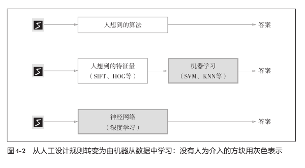
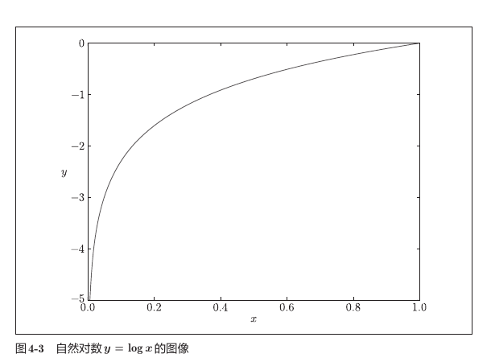
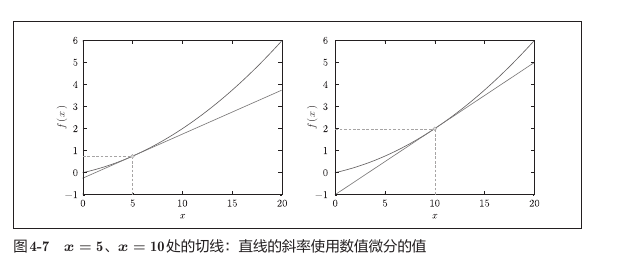
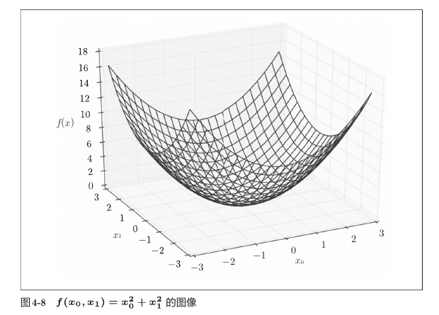
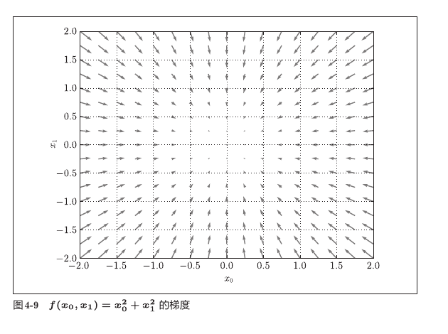
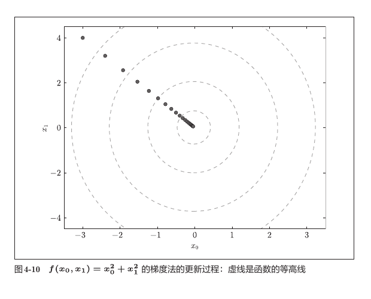
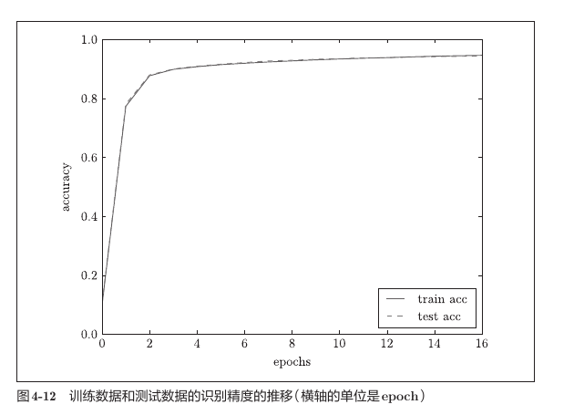

# 第四章 神经网络的学习

## 1. 本章核心

第三章解决的是“已经有参数时，神经网络怎样得到预测结果”；第四章开始解决真正的学习问题：**怎样利用训练数据自动确定权重和偏置**。

本章最重要的主线是：

```text
从训练数据中随机抽取 mini-batch
                ↓
使用当前参数进行前向传播
                ↓
用损失函数衡量预测有多差
                ↓
计算损失函数关于各参数的梯度
                ↓
沿梯度的反方向更新参数
                ↓
反复执行，逐渐减小损失
```

必须掌握的结论：

- 神经网络的“学习”就是自动调整权重和偏置；
- 训练时以损失函数为指标，不直接以准确率为指标；
- mini-batch 用少量样本近似整个训练集，降低一次更新的计算量；
- 导数表示一维函数在某点的变化率，梯度是多变量函数各偏导数组成的向量；
- 梯度指向函数值上升最快的方向，所以梯度下降沿负梯度方向更新；
- 学习率控制每一步走多远，过大或过小都不好；
- 训练数据用于学习参数，测试数据用于评价泛化能力；
- 数值梯度原理简单、精度较可靠，但速度极慢，主要用于理解和梯度检查；
- 实际训练使用高效梯度算法，本章代码中的 `gradient()` 是反向传播版实现。

## 2. 从数据中学习

### 2.1 什么是“学习”

神经网络的参数包括各层的权重和偏置。学习的目标是：根据训练数据，自动找到一组使预测误差尽可能小的参数。

传统方法通常需要人先总结规则，或者先人工设计特征；深度学习则可以直接从原始数据中学习重要特征。



图中灰色部分表示需要机器从数据中学习的部分：

```text
人工规则：       人设计完整算法
传统机器学习：   人设计特征量，机器学习分类方法
神经网络：       机器直接从原始数据中学习特征和分类方法
```

因此，神经网络常被称为端到端学习：

```text
原始输入 → 神经网络 → 最终答案
```

需要注意，端到端并不意味着完全不需要人参与。网络结构、学习率、批大小等超参数仍然需要人为设定和调整。

### 2.2 训练数据与测试数据

- **训练数据**：用来计算梯度并更新参数；
- **测试数据**：不参与参数更新，只用来检查模型处理未知数据的能力。

模型不仅要在见过的数据上表现好，还要对没见过的数据作出正确判断，这种能力叫作**泛化能力**。

不能使用测试数据反复调整参数或选择模型，否则测试数据会间接参与学习，测试结果就不能再代表真正的泛化能力。

```text
训练集 ──> 学习 W、b
测试集 ──> 最终评价泛化能力（不更新 W、b）
```

## 3. 损失函数

损失函数把“预测有多差”转换成一个数值：

```text
预测越接近正确答案 → 损失越小
预测越偏离正确答案 → 损失越大
```

学习的目标就是寻找使损失函数尽可能小的参数。

### 3.1 均方误差

均方误差为：

$$
E=\frac{1}{2}\sum_k(y_k-t_k)^2
$$

其中：

- $y_k$：神经网络对第 $k$ 类的输出；
- $t_k$：正确标签；
- $\frac{1}{2}$：便于后续求导，使平方项求导产生的 `2` 被抵消。

实现：

```python
def mean_squared_error(y, t):
    return 0.5 * np.sum((y - t) ** 2)
```

例子：正确答案是数字 `2`。

```python
t = [0, 0, 1, 0, 0, 0, 0, 0, 0, 0]
```

如果网络给数字 `2` 较高概率，均方误差较小；如果给错误类别较高概率，均方误差较大。

### 3.2 交叉熵误差

单个样本的交叉熵误差为：

$$
E=-\sum_k t_k\log y_k
$$

当 `t` 是 one-hot 标签时，只有正确类别对应的 $t_k=1$，其他位置都是 `0`，因此公式实际等价于：

$$
E=-\log(\text{正确类别的预测概率})
$$

例如：

| 正确类别的预测概率 | 交叉熵误差 |
| ---: | ---: |
| `0.9` | `-log(0.9) ≈ 0.105` |
| `0.6` | `-log(0.6) ≈ 0.511` |
| `0.1` | `-log(0.1) ≈ 2.303` |
| `0.01` | `-log(0.01) ≈ 4.605` |



教材图中画的是 $\log x$，而交叉熵使用的是 $-\log x$，所以要把图中纵坐标的符号反过来理解：

- 正确概率接近 `1`：$-\log y$ 接近 `0`，损失小；
- 正确概率接近 `0`：$-\log y$ 急剧增大，损失大；
- 对“非常自信但答错”的预测，交叉熵会给出很重的惩罚。

实现：

```python
def cross_entropy_error(y, t):
    delta = 1e-7
    return -np.sum(t * np.log(y + delta))
```

加入 `delta` 是为了避免：

```python
np.log(0)  # -inf
```

### 3.3 为什么不用准确率直接学习

准确率只在预测类别改变时才发生变化。例如，100张图片中答对32张时，准确率始终是 `0.32`；参数发生一些微小变化，但仍然答对32张时，准确率完全不变。

```text
参数小幅变化 ──> 准确率可能仍为 32% ──> 无法知道参数该往哪边调整
参数小幅变化 ──> 损失发生连续变化   ──> 能得到有效梯度
```

如果把准确率作为目标，大多数位置的导数会是 `0`，无法提供细腻的更新方向。损失函数通常连续变化，能反映参数的微小改动，因此可以利用梯度逐步优化。

这也解释了为什么隐藏层需要 Sigmoid、ReLU 等能提供梯度信息的激活函数，而不能使用几乎处处导数为 `0` 的阶跃函数进行学习。

## 4. mini-batch 学习

### 4.1 为什么需要 mini-batch

MNIST 有60000个训练样本。如果每更新一次参数都计算全部数据，代价很高。因此，每次随机抽取一小批样本，用这一批的平均损失近似整个训练集的平均损失。

对 $N$ 个样本，mini-batch 版交叉熵为：

$$
E=-\frac{1}{N}\sum_{n=1}^{N}\sum_k t_{nk}\log y_{nk}
$$

除以 $N$ 得到平均损失，使损失值不会随着批大小简单成倍变化，也更容易比较不同批次。

### 4.2 随机抽取 mini-batch

```python
train_size = x_train.shape[0]       # 60000
batch_size = 100
batch_mask = np.random.choice(train_size, batch_size)
x_batch = x_train[batch_mask]
t_batch = t_train[batch_mask]
```

形状变化：

```text
x_train:    (60000, 784)
t_train:    (60000, 10)
batch_mask: (100,)
                    ↓ 按索引抽取
x_batch:    (100, 784)
t_batch:    (100, 10)
```

`x_batch` 和 `t_batch` 必须使用同一个 `batch_mask`，才能保证每张图片仍与自己的正确标签对应。

### 4.3 mini-batch 交叉熵的实现

当前公共函数支持 one-hot 标签和类别编号两种形式：

```python
def cross_entropy_error(y, t):
    if y.ndim == 1:
        t = t.reshape(1, t.size)
        y = y.reshape(1, y.size)

    if t.size == y.size:
        t = t.argmax(axis=1)

    batch_size = y.shape[0]
    return -np.sum(
        np.log(y[np.arange(batch_size), t] + 1e-7)
    ) / batch_size
```

以 `batch_size=100` 为例，形状变化为：

```text
y:                              (100, 10)
t（one-hot）:                   (100, 10)
t.argmax(axis=1):               (100,)
np.arange(batch_size):          (100,)
y[np.arange(batch_size), t]:    (100,)
np.sum(...)/batch_size:         标量
```

高级索引：

```python
y[np.arange(batch_size), t]
```

表示从每一行取出该样本正确类别的概率：

```text
y[0, t[0]], y[1, t[1]], ..., y[99, t[99]]
```

## 5. 数值微分

### 5.1 导数的含义

导数表示函数在某一点附近的变化率，也就是该点切线的斜率：

$$
\frac{df(x)}{dx}=\lim_{h\to0}\frac{f(x+h)-f(x)}{h}
$$

计算机不能直接令 $h=0$，只能使用很小的数近似计算。

### 5.2 中心差分

教材使用中心差分：

$$
\frac{df(x)}{dx}\approx\frac{f(x+h)-f(x-h)}{2h}
$$

```python
def numerical_diff(f, x):
    h = 1e-4
    return (f(x + h) - f(x - h)) / (2 * h)
```

与只使用 `f(x+h)-f(x)` 的前向差分相比，中心差分同时观察左右两侧，通常误差更小。

为什么使用 `h=1e-4`，而不是非常接近0的数？

- `h` 太大：近似区间太宽，不能准确表示该点的瞬时斜率；
- `h` 太小：浮点数舍入误差会使 `f(x+h)` 和 `f(x-h)` 难以区分；
- `1e-4` 是教材示例中兼顾二者的经验值。

### 5.3 切线的理解

对函数：

$$
f(x)=0.01x^2+0.1x
$$

在某一点求得数值导数 $k$ 后，切线为：

$$
y=kx+b
$$

其中：

$$
b=f(x_0)-kx_0
$$



图中切线只在所选点附近代表函数的变化趋势。随着位置改变，曲线的斜率也会改变。

当前代码在 `x=5` 时输出：

```text
0.1999999999990898
```

理论导数为：

$$
f'(x)=0.02x+0.1
$$

代入 `x=5` 得到 `0.2`，说明数值微分结果非常接近理论值。

## 6. 偏导数与梯度

### 6.1 偏导数

对于二元函数：

$$
f(x_0,x_1)=x_0^2+x_1^2
$$

它的图像像一个碗，最低点在原点：



函数有多个变量时，只让其中一个变量变化、把其他变量暂时固定，得到的导数叫偏导数：

$$
\frac{\partial f}{\partial x_0}=2x_0,
\qquad
\frac{\partial f}{\partial x_1}=2x_1
$$

例如在点 `(3, 4)`：

$$
\frac{\partial f}{\partial x_0}=6,
\qquad
\frac{\partial f}{\partial x_1}=8
$$

### 6.2 梯度

把所有变量的偏导数排列在一起，就得到梯度：

$$
\nabla f=
\left(
\frac{\partial f}{\partial x_0},
\frac{\partial f}{\partial x_1}
\right)
$$

对上面的函数：

$$
\nabla f=(2x_0,2x_1)
$$

在 `(3, 4)` 处：

```text
梯度 ∇f = (6, 8)
负梯度 -∇f = (-6, -8)
```

梯度是一个向量，同时包含：

- 方向：函数值增加最快的方向；
- 大小：函数在该位置变化得有多快。

### 6.3 梯度图为什么指向原点



需要特别注意：教材的绘图代码使用了 `-grad`，因此图中的箭头是**负梯度**，不是梯度本身：

```python
plt.quiver(X, Y, -grad[:, 0], -grad[:, 1])
```

对 $f=x_0^2+x_1^2$：

```text
梯度：   (2x0, 2x1)    指向远离原点的上坡方向
负梯度： (-2x0, -2x1)  指向靠近原点的下坡方向
```

所以图中的箭头都指向原点。离原点越远，梯度绝对值越大，箭头也越长；原点处梯度为 `(0, 0)`。

一般函数中，梯度为零的地方不一定是全局最小值，也可能是局部最小值、局部最大值或鞍点。

## 7. 梯度下降法

### 7.1 参数更新公式

为了减小函数值，需要沿梯度的反方向移动：

$$
x_0\leftarrow x_0-\eta\frac{\partial f}{\partial x_0}
$$

$$
x_1\leftarrow x_1-\eta\frac{\partial f}{\partial x_1}
$$

统一写成向量形式：

$$
\boldsymbol{x}\leftarrow\boldsymbol{x}-\eta\nabla f(\boldsymbol{x})
$$

$\eta$ 是学习率，决定每一步移动多远。

### 7.2 梯度下降实现

```python
def gradient_descent(f, init_x, lr=0.01, step_num=100):
    x = init_x
    x_history = []

    for _ in range(step_num):
        x_history.append(x.copy())
        grad = numerical_gradient(f, x)
        x -= lr * grad

    return x, np.array(x_history)
```

以：

```python
init_x = np.array([-3.0, 4.0])
lr = 0.1
step_num = 20
```

为例，更新轨迹逐步接近最低点 `(0, 0)`：



当前代码运行20步后输出约为：

```text
[-0.03458765  0.04611686]
```

### 7.3 `x.copy()` 为什么重要

```python
x_history.append(x.copy())
```

如果直接保存 `x`：

```python
x_history.append(x)
```

列表中的每一项都可能引用同一个数组，后续原地更新 `x` 时，历史记录也会跟着改变。`copy()` 会保存当时的独立快照。

### 7.4 学习率的影响

| 学习率情况 | 可能结果 |
| --- | --- |
| 过大 | 一步跨过低点，来回震荡，甚至发散 |
| 合适 | 稳定、较快地接近低点 |
| 过小 | 每一步变化极小，收敛非常慢 |

学习率是超参数：它不是从训练中自动学习的权重，而是由人预先设定并通过实验选择。

## 8. 神经网络的梯度

神经网络要计算的是损失函数 $L$ 关于权重和偏置的梯度。

假设：

```text
W.shape = (2, 3)
```

那么：

```text
dW.shape = (2, 3)
```

对应关系为：

```text
W[i, j]  ↔  dW[i, j] = ∂L/∂W[i, j]
```

梯度与参数形状必须相同，因为参数中的每一个元素都需要一个对应的更新量。

### 8.1 `SimpleNet` 的计算

```python
self.W = np.random.randn(2, 3)
x = np.array([0.6, 0.9])
```

形状变化：

```text
x:          (2,)
W:          (2, 3)
dot(x, W):  (3,)
softmax:    (3,)
loss:       标量
dW:         (2, 3)
```

数值梯度依次让 `W` 的6个元素分别加、减 `h`，观察损失如何变化，从而得到6个偏导数。

## 9. 两层神经网络

### 9.1 网络参数

当前网络：

```python
network = TwoLayerNet(
    input_size=784,
    hidden_size=50,
    output_size=10,
)
```

参数形状：

| 参数 | 形状 | 作用 | 参数个数 |
| --- | ---: | --- | ---: |
| `W1` | `(784, 50)` | 输入层到隐藏层 | 39200 |
| `b1` | `(50,)` | 隐藏层偏置 | 50 |
| `W2` | `(50, 10)` | 隐藏层到输出层 | 500 |
| `b2` | `(10,)` | 输出层偏置 | 10 |
| 合计 |  |  | 39760 |

### 9.2 mini-batch 前向传播

以一次输入100张图片为例：

```text
x_batch
(100, 784)
      │
      │ dot W1 (784, 50) + b1 (50,)
      ▼
a1
(100, 50)
      │ sigmoid（形状不变）
      ▼
z1
(100, 50)
      │
      │ dot W2 (50, 10) + b2 (10,)
      ▼
a2
(100, 10)
      │ softmax（形状不变）
      ▼
y
(100, 10)
      │ 与 t_batch (100, 10) 计算交叉熵
      ▼
loss
标量
```

矩阵乘法规则：

```text
(100, 784) · (784, 50) → (100, 50)
(100, 50)  · (50, 10)  → (100, 10)
```

偏置利用广播加到每个样本：

```text
(100, 50) + (50,) → (100, 50)
(100, 10) + (10,) → (100, 10)
```

### 9.3 反向传播中的形状

当前 `gradient()` 的核心代码：

```python
dy = (y - t) / batch_num
grads["W2"] = np.dot(z1.T, dy)
grads["b2"] = np.sum(dy, axis=0)

da1 = np.dot(dy, W2.T)
dz1 = sigmoid_grad(a1) * da1
grads["W1"] = np.dot(x.T, dz1)
grads["b1"] = np.sum(dz1, axis=0)
```

形状逐步变化：

```text
y, t:              (100, 10)
dy:                 (100, 10)

z1.T:               (50, 100)
z1.T · dy:          (50, 100) · (100, 10) → (50, 10) = dW2
sum(dy, axis=0):    (10,) = db2

W2.T:               (10, 50)
dy · W2.T:          (100, 10) · (10, 50) → (100, 50) = da1
sigmoid_grad(a1):   (100, 50)
dz1:                (100, 50)

x.T:                (784, 100)
x.T · dz1:          (784, 100) · (100, 50) → (784, 50) = dW1
sum(dz1, axis=0):   (50,) = db1
```

最终再次验证规律：

```text
W1 ↔ dW1: (784, 50)
b1 ↔ db1: (50,)
W2 ↔ dW2: (50, 10)
b2 ↔ db2: (10,)
```

### 9.4 数值梯度与反向传播梯度

两者目标相同，都是求损失关于参数的梯度：

| 方法 | 优点 | 缺点 | 主要用途 |
| --- | --- | --- | --- |
| 数值梯度 | 原理直接，实现可靠 | 极慢 | 理解梯度、检查反向传播 |
| 反向传播 | 速度快，适合训练 | 推导与实现较复杂 | 实际训练 |

当前网络有39760个参数。中心差分计算每个参数需要两次损失，因此一次数值梯度大约需要：

```text
39760 × 2 = 79520 次前向传播
```

所以使用：

```python
network.numerical_gradient(x_batch, t_batch)
```

完整训练会非常慢。当前训练代码使用：

```python
network.gradient(x_batch, t_batch)
```

可以一次高效得到全部梯度。

本次验证中，反向传播梯度与数值梯度的最大绝对误差约为：

```text
3.25e-08
```

说明两种实现给出的结果基本一致。

## 10. mini-batch 训练流程

神经网络学习的四个步骤：

1. 随机选取 mini-batch；
2. 计算损失关于参数的梯度；
3. 沿负梯度方向更新参数；
4. 重复以上步骤。

核心代码：

```python
for i in range(iters_num):
    batch_mask = np.random.choice(train_size, batch_size)
    x_batch = x_train[batch_mask]
    t_batch = t_train[batch_mask]

    grad = network.gradient(x_batch, t_batch)

    for key in ("W1", "W2", "b1", "b2"):
        network.params[key] -= learning_rate * grad[key]

    loss = network.loss(x_batch, t_batch)
    train_loss_list.append(loss)
```

这种每次随机选择一批数据进行参数更新的方法叫作**随机梯度下降法**（SGD）。

参数更新时形状不变，只改变数值：

```text
W1: (784, 50) - 0.1 × (784, 50) → (784, 50)
b1: (50,)     - 0.1 × (50,)     → (50,)
W2: (50, 10)  - 0.1 × (50, 10)  → (50, 10)
b2: (10,)     - 0.1 × (10,)     → (10,)
```

### 10.1 epoch

一个 epoch 表示相当于把全部训练数据看过一遍的训练量。

```python
iter_per_epoch = max(train_size / batch_size, 1)
```

MNIST 中：

```text
train_size = 60000
batch_size = 100
iter_per_epoch = 600
```

所以大约每更新600次参数，就记录一次训练集和测试集准确率。由于代码使用随机抽样，“一个 epoch”是样本数量意义上的一遍，不保证每张图片恰好出现一次。

### 10.2 训练准确率与测试准确率



- 两条曲线一起上升且接近：学习有效，泛化情况正常；
- 训练准确率继续上升、测试准确率停滞或下降：可能发生过拟合；
- 两者都很低：可能训练不足、学习率不合适或模型能力不足。

教材图中训练与测试曲线几乎重合，说明该实验没有明显过拟合。

## 11. 本章代码与结果

| 文件 | 作用 | 主要结果 |
| --- | --- | --- |
| `gradient_1d.py` | 一维数值微分并绘制切线 | `x=5` 处导数约为 `0.2` |
| `gradient_2d.py` | 计算二维函数的梯度并绘制负梯度场 | 箭头指向函数低值方向 |
| `gradient_method.py` | 实现梯度下降并记录轨迹 | `[-3,4]` 逐步接近 `[0,0]` |
| `gradient_simplenet.py` | 计算简单网络权重梯度 | `dW.shape == W.shape == (2,3)` |
| `two_layer_net.py` | 实现预测、损失、准确率、数值梯度及快速梯度 | 梯度检查误差约 `3.25e-08` |
| `train_neuralnet.py` | 使用 MNIST mini-batch 训练并评价模型 | 记录损失及每个 epoch 的准确率 |

真实 MNIST mini-batch 更新一步的验证结果：

```text
loss: 2.2995559723 → 2.2909173462
```

损失下降说明梯度方向和参数更新能够正常工作。单次随机实验的具体数值会因初始权重和抽取样本不同而变化。

## 12. 常见易错点

### 12.1 把梯度方向理解反了

```text
梯度 ∇f：函数值上升最快的方向
负梯度 -∇f：函数值下降最快的方向
```

梯度下降更新公式中必须有减号：

```python
x -= learning_rate * grad
```

### 12.2 忘记还原数值微分中被修改的参数

```python
tmp_val = x[idx]
x[idx] = tmp_val + h
fxh1 = f(x)
x[idx] = tmp_val - h
fxh2 = f(x)
x[idx] = tmp_val
```

最后一行非常重要，否则计算下一个元素时，前一个元素仍处于被修改的状态。

### 12.3 使用整数数组计算梯度

```python
grad = np.zeros_like(x)
```

如果 `x` 是整数数组，`grad` 也会是整数数组，小数梯度可能被截断。初始值应写成浮点数：

```python
np.array([-3.0, 4.0])
```

### 12.4 参数名不一致

训练代码使用：

```python
network.params[key]
```

因此网络类也必须统一使用 `self.params`，不能一处写 `params`、另一处写 `param_`。

### 12.5 数值梯度看起来像“卡住”

`numerical_gradient()` 会对近四万个参数逐个做中心差分，并非死循环。它不适合运行数万次完整训练；训练应使用快速的 `gradient()`。

### 12.6 教材相对路径依赖运行目录

```python
sys.path.append(os.pardir)
```

教材写法假设先进入 `ch04` 再运行：

```bash
cd ch04
python train_neuralnet.py
```

如果直接在仓库根目录运行某些脚本，`os.pardir` 指向的位置可能不同，从而找不到 `common` 或 `dataset`。

### 12.7 当前代码中的 `markers` 没有被使用

```python
markers = {"train": "o", "test": "s"}
```

仅定义字典不会让曲线自动出现标记，需要显式传入：

```python
plt.plot(x, train_acc_list, marker=markers["train"])
```

这不影响神经网络训练，只影响绘图样式。

## 13. 本章复习速记

```text
学习目标：让损失函数尽可能小

一次迭代：
mini-batch → 前向传播 → 损失 → 梯度 → 参数更新

更新公式：
参数 ← 参数 - 学习率 × 梯度

方向：
梯度是上坡，负梯度是下坡

梯度形状：
参数的梯度与参数形状完全相同

数据分工：
训练集学习参数，测试集评价泛化能力

效率：
数值梯度用于理解和检查，反向传播梯度用于实际训练
```

## 14. 本章一句话总结

第四章建立了神经网络学习的完整闭环：从训练数据中抽取 mini-batch，用损失函数评价当前参数，通过梯度找到减小损失的方向，再用梯度下降不断更新权重和偏置，并使用独立测试数据检查模型能否泛化到未知样本。

---

本文中的教材插图均截取自本仓库 `docs` 目录下的《深度学习入门：基于 Python 的理论与实现》第四章，仅用于个人学习和复习。
