# 第五章 误差反向传播法

## 1. 本章核心

第四章已经建立了神经网络的学习流程，但使用数值微分逐个计算参数的梯度，速度非常慢。第五章解决的核心问题是：**怎样利用误差反向传播法，一次高效地求出所有参数的梯度。**

本章主线如下：

```text
正向传播：输入 → 各层依次计算 → 预测结果 → 损失
                                  ↓
反向传播：参数梯度 ← 各层反向计算 ← 预测误差
                                  ↓
                     使用梯度下降更新参数
```

必须掌握的结论：

- 计算图把复杂计算拆成多个简单的局部计算；
- 正向传播从输入走向输出，计算各节点的结果；
- 反向传播从损失走回输入，计算损失关于各变量的导数；
- 反向传播的数学基础是链式法则；
- 每一层都通过 `forward()` 和 `backward()` 封装自己的计算规则；
- 加法层把上游梯度原样传给两个输入；
- 乘法层把上游梯度分别乘以另一个输入；
- ReLU 像控制梯度是否通过的开关，Sigmoid 的反向传播可利用正向输出计算；
- Affine 层的反向传播必须同时注意矩阵乘法和形状；
- 批处理时，偏置梯度需要沿样本轴求和；
- Softmax 与交叉熵组合后，反向传播得到简洁的 `(Y - T) / N`；
- 数值梯度主要用于检查反向传播，真正训练使用高速反向传播；
- 反向传播负责求梯度，梯度下降负责使用梯度更新参数，二者不是同一件事。

## 2. 计算图

### 2.1 节点、边与正向传播

计算图用节点表示局部运算，用箭头表示数据的流动。例如购买苹果和橘子时，可以把乘法、加法和消费税拆成多个节点：

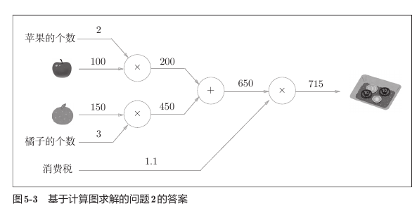

图中的正向计算过程为：

```text
苹果：100 × 2 = 200
橘子：150 × 3 = 450
合计：200 + 450 = 650
含税：650 × 1.1 = 715
```

从左向右计算称为正向传播：

```text
输入变量 → 局部计算 → 中间结果 → 局部计算 → 最终输出
```

### 2.2 局部计算

一个节点只关心自己的输入和运算，不需要知道输入之前经历了什么。

例如加法节点收到 `200` 和 `450` 时，只需要完成：

```text
200 + 450 → 650
```

它不需要知道 `200` 是怎样由苹果得到的，也不需要知道 `450` 是怎样由橘子得到的。大量简单的局部计算连接起来，就可以组成复杂的全局计算。

这种设计有两个重要优点：

- 每个节点的职责简单，便于理解、实现和检查；
- 中间结果可以保存下来，在反向传播时重复使用。

### 2.3 反向传播在计算什么

假设最终输出是损失 $L$，某个中间变量是 $x$。反向传播计算的是：

$$
\frac{\partial L}{\partial x}
$$

它表示：当 $x$ 发生微小变化时，最终损失 $L$ 会受到多大影响。

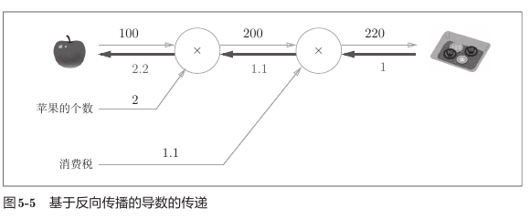

图中从最终金额开始，以 `1` 为起点向左传播：

```text
1 → 1.1 → 2.2
```

所以最终金额关于苹果单价的导数是 `2.2`。苹果单价发生一个很小的变化时，最终金额大约发生该变化量 `2.2` 倍的变化。

```text
正向传播：计算结果，从左向右
反向传播：计算导数，从右向左
```

## 3. 链式法则

### 3.1 一般节点的反向传播

假设某个节点的正向计算为：

$$
y=f(x)
$$

反向传播时，上游传来：

$$
dout=\frac{\partial L}{\partial y}
$$

当前节点计算自己的局部导数：

$$
\frac{\partial y}{\partial x}
$$

再根据链式法则得到传给下游的梯度：

$$
dx=\frac{\partial L}{\partial x}
=\frac{\partial L}{\partial y}
\frac{\partial y}{\partial x}
$$

因此，每个 `backward()` 做的核心工作都是：

```text
下游梯度 = 上游梯度 × 当前节点的局部导数
```

### 3.2 链式法则示例

设：

$$
t=x+y
$$

$$
z=t^2
$$

那么：

$$
\frac{\partial z}{\partial x}
=
\frac{\partial z}{\partial t}
\frac{\partial t}{\partial x}
=2t\times1
=2(x+y)
$$

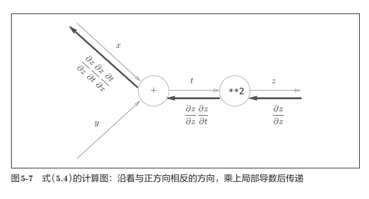

图中的粗箭头表示反向传播。梯度每经过一个节点，就乘上该节点的局部导数，连续相乘后得到最终导数。

### 3.3 为什么反向传播从 `1` 开始

网络的最终输出是损失 $L$。反向传播的起点为：

$$
\frac{\partial L}{\partial L}=1
$$

因此代码中写：

```python
dout = 1
dout = last_layer.backward(dout)
```

这个 `1` 不是随意规定的，而是“损失对自身的导数”。

## 4. 加法层与乘法层

### 4.1 加法层

正向传播：

$$
z=x+y
$$

因为：

$$
\frac{\partial z}{\partial x}=1,
\qquad
\frac{\partial z}{\partial y}=1
$$

所以反向传播为：

$$
dx=dout,
\qquad
dy=dout
$$

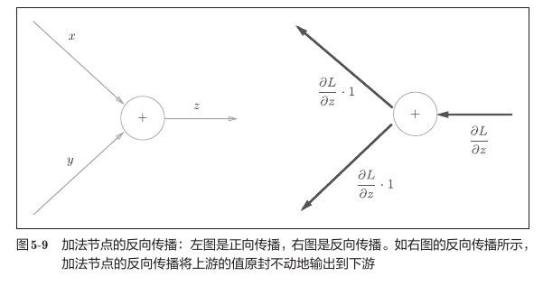

加法节点的直觉是：**把上游梯度原样复制给两个输入。**

```python
class AddLayer:
    def forward(self, x, y):
        return x + y

    def backward(self, dout):
        dx = dout
        dy = dout
        return dx, dy
```

加法的局部导数恒为 `1`，因此不需要保存正向传播的输入。当前 `layer_naive.py` 也把 `x`、`y` 保存成了实例变量，这不会影响结果，但 `AddLayer.backward()` 实际没有使用它们，可以省略。

### 4.2 乘法层

正向传播：

$$
z=xy
$$

局部导数为：

$$
\frac{\partial z}{\partial x}=y,
\qquad
\frac{\partial z}{\partial y}=x
$$

所以反向传播为：

$$
dx=dout\times y,
\qquad
dy=dout\times x
$$

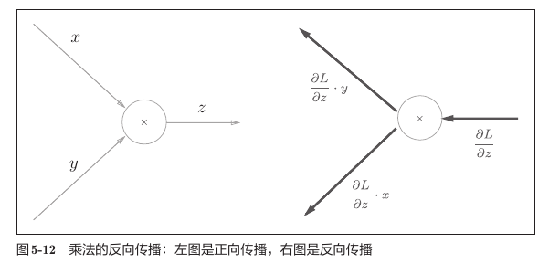

乘法节点的直觉是：**把两个输入交换后，分别乘以上游梯度。**

```python
class MulLayer:
    def __init__(self):
        self.x = None
        self.y = None

    def forward(self, x, y):
        self.x = x
        self.y = y
        return x * y

    def backward(self, dout):
        dx = dout * self.y
        dy = dout * self.x
        return dx, dy
```

乘法的反向传播需要另一个输入的值，所以必须在正向传播时保存 `x` 和 `y`。

### 4.3 两种节点的对比

| 节点 | 正向传播 | 反向传播 | 是否需要保存输入 |
| --- | --- | --- | --- |
| 加法 | `x + y` | `dx=dout`，`dy=dout` | 不需要 |
| 乘法 | `x * y` | `dx=dout*y`，`dy=dout*x` | 需要 |

## 5. 用层组合复杂计算

每一层都使用相同接口：

```python
layer.forward(...)
layer.backward(dout)
```

购买苹果和橘子的完整传播过程如下：

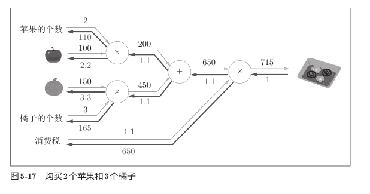

正向传播必须按照计算顺序调用：

```text
苹果乘法层 ─┐
             ├→ 加法层 → 税率乘法层 → 715
橘子乘法层 ─┘
```

反向传播必须完全反过来：

```text
税率乘法层 → 加法层 → 苹果乘法层、橘子乘法层
```

当前代码输出：

```text
price = 715.00
dapple = 2.20
dapple_num = 110.00
dorange = 3.30
dorange_num = 165.00
dtax = 650.00
```

这些导数可以解释为变量对最终价格的影响程度。例如：

```text
dapple = 2.2
```

表示苹果单价增加一个很小的量时，最终含税价格大约增加该变化量的 `2.2` 倍。

## 6. 激活函数层

### 6.1 ReLU 层

ReLU 的正向传播为：

$$
y=
\begin{cases}
x, & x>0 \\
0, & x\leq0
\end{cases}
$$

反向传播为：

$$
dx=
\begin{cases}
dout, & x>0 \\
0, & x\leq0
\end{cases}
$$

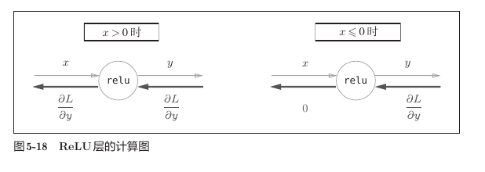

ReLU 可以理解成梯度开关：

```text
正向输入 x > 0  → 开关打开 → 梯度原样通过
正向输入 x <= 0 → 开关关闭 → 梯度变为 0
```

实现：

```python
class Relu:
    def __init__(self):
        self.mask = None

    def forward(self, x):
        self.mask = (x <= 0)
        out = x.copy()
        out[self.mask] = 0
        return out

    def backward(self, dout):
        dout[self.mask] = 0
        return dout
```

`mask=True` 的位置表示正向输入小于等于 `0`，这些位置在反向传播时必须把梯度清零。

严格来说，ReLU 在 `x=0` 处不可导；实现中按照常见约定，把该位置的梯度设为 `0`。

形状不会改变：

```text
x:    (N, H)
out:  (N, H)
dout: (N, H)
dx:   (N, H)
mask: (N, H)
```

### 6.2 Sigmoid 层

Sigmoid 的正向传播为：

$$
y=\frac{1}{1+e^{-x}}
$$

它的导数可以整理为：

$$
\frac{\partial y}{\partial x}=y(1-y)
$$

所以反向传播为：

$$
dx=dout\times y(1-y)
$$

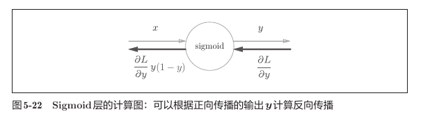

实现：

```python
class Sigmoid:
    def __init__(self):
        self.out = None

    def forward(self, x):
        out = sigmoid(x)
        self.out = out
        return out

    def backward(self, dout):
        dx = dout * (1.0 - self.out) * self.out
        return dx
```

这里保存的是正向传播输出 `y`，反向传播可以直接使用 `y(1-y)`，不需要重新计算指数函数。

## 7. Affine 层

### 7.1 Affine 层做什么

神经网络中的加权和：

```python
Y = np.dot(X, W) + B
```

可以写成：

$$
Y=XW+B
$$

这个“矩阵乘法加偏置”的运算称为仿射变换，因此封装成 `Affine` 层。

### 7.2 批处理的正向传播

设：

```text
N：batch 大小
D：输入特征数
H：输出特征数
```

各变量形状为：

```text
X: (N, D)
W: (D, H)
B: (H,)
Y: (N, H)
```

矩阵乘法和广播过程为：

```text
(N, D) @ (D, H) → (N, H)
(N, H) + (H,)    → (N, H)
```

偏置 `B` 会通过广播加到 batch 中的每一个样本上。

### 7.3 Affine 层的反向传播

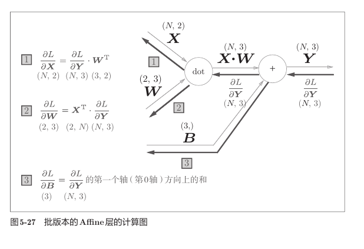

设上游梯度为：

```text
dY: (N, H)
```

反向传播公式为：

$$
dX=dY W^T
$$

$$
dW=X^T dY
$$

$$
dB=\sum_{n=1}^{N}dY_n
$$

用形状验证：

```text
dX = dY @ W.T
     (N,H) @ (H,D) → (N,D)

dW = X.T @ dY
     (D,N) @ (N,H) → (D,H)

dB = sum(dY, axis=0)
     (N,H)          → (H,)
```

必须满足：

```text
dX.shape == X.shape
dW.shape == W.shape
dB.shape == B.shape
```

形状是检查 Affine 反向传播最可靠的方法。尤其要注意：

```python
self.dW = np.dot(self.x.T, dout)
```

必须是 `X.T @ dout`，不能把转置和相乘顺序写反。

### 7.4 为什么偏置梯度要沿 `axis=0` 求和

正向传播时，同一个偏置被加到每个样本上：

```text
第1个样本：Y[0] = XW[0] + B
第2个样本：Y[1] = XW[1] + B
...
第N个样本：Y[N-1] = XW[N-1] + B
```

同一个 `B[j]` 同时影响所有样本的 `Y[:, j]`。因此反向传播时，需要把所有样本对该偏置的影响汇总：

```python
self.db = np.sum(dout, axis=0)
```

例如：

```python
dout = np.array([
    [1, 2, 3],
    [4, 5, 6],
])

db = np.sum(dout, axis=0)
# [5, 7, 9]
```

形状变化：

```text
dout: (2, 3)
           ↓ 沿第0轴把两条样本相加
db:    (3,)
```

### 7.5 Affine 层实现

```python
class Affine:
    def __init__(self, W, b):
        self.W = W
        self.b = b
        self.x = None
        self.dW = None
        self.db = None

    def forward(self, x):
        self.x = x
        return np.dot(x, self.W) + self.b

    def backward(self, dout):
        dx = np.dot(dout, self.W.T)
        self.dW = np.dot(self.x.T, dout)
        self.db = np.sum(dout, axis=0)
        return dx
```

项目中的 `common/layers.py` 还会先保存原始输入形状，并把图像张量暂时展开成二维数组；反向传播结束后再恢复原形状。因此同一个 Affine 层也能处理卷积网络传来的四维输入。

## 8. SoftmaxWithLoss 层

### 8.1 推理阶段与学习阶段

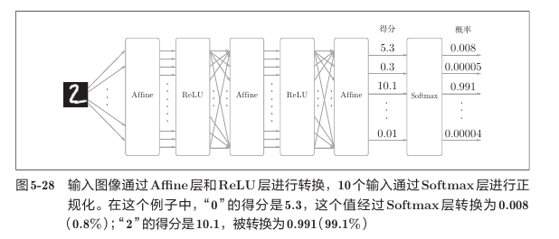

最后一个 Affine 层输出的是类别得分。Softmax 将得分转换成总和为 `1` 的概率。

```text
推理阶段：只需要最大类别时，可直接对得分使用 argmax
学习阶段：需要 Softmax 概率和交叉熵损失
```

Softmax 不会改变各类别得分的大小顺序，因此：

```text
argmax(scores) == argmax(softmax(scores))
```

### 8.2 正向传播

`SoftmaxWithLoss` 把 Softmax 和交叉熵误差合成一层：

```python
def forward(self, x, t):
    self.t = t
    self.y = softmax(x)
    self.loss = cross_entropy_error(self.y, self.t)
    return self.loss
```

对 batch 中的 $N$ 个样本，平均交叉熵为：

$$
L=-\frac{1}{N}
\sum_{n=1}^{N}
\sum_k T_{nk}\log Y_{nk}
$$

其中：

- `x`：前一层输出的类别得分；
- `Y`：Softmax 输出的概率；
- `T`：正确标签；
- `L`：整个 mini-batch 的平均损失，是一个标量。

### 8.3 反向传播为什么是 `(Y-T)/N`

Softmax 和交叉熵组合后，可以把复杂的求导结果整理为：

$$
dX=\frac{Y-T}{N}
$$

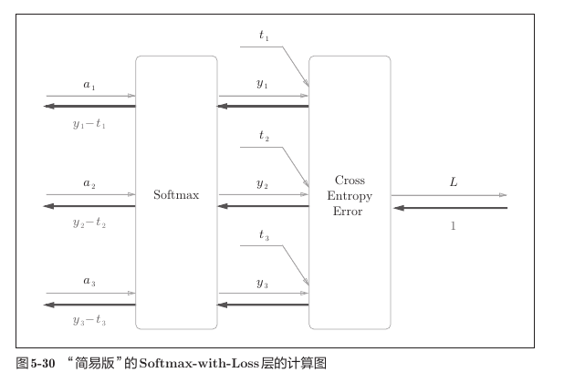

这个结果非常直观：

```text
预测概率 Y - 正确标签 T = 当前预测误差
```

如果正确标签为：

```python
T = [0, 1, 0]
```

预测很差时：

```text
Y = [0.3, 0.2, 0.5]
Y - T = [0.3, -0.8, 0.5]
```

传回去的误差较大，前面的参数需要进行较大调整。

预测很好时：

```text
Y = [0.01, 0.99, 0.00]
Y - T = [0.01, -0.01, 0.00]
```

传回去的误差很小，参数只需进行微小调整。

### 8.4 为什么要除以 batch 大小

前向传播计算的是 $N$ 个样本的平均损失：

$$
L=\frac{L_1+L_2+\cdots+L_N}{N}
$$

对平均损失求导时，系数 $1/N$ 会被保留下来，所以：

$$
\frac{\partial L}{\partial X}
=\frac{Y-T}{N}
$$

从形状上看：

```text
Y:       (N, C)
T:       (N, C)
Y - T:   (N, C)
除以 N:  (N, C)  形状不变，只缩放每个元素
loss:    标量
```

除以 `N` 的目的不是改变形状，而是让每个样本分担平均损失的梯度。这样 batch 大小从 `10` 改为 `100` 时，梯度不会仅因为样本数量增加而简单放大10倍。

实现：

```python
def backward(self, dout=1):
    batch_size = self.t.shape[0]
    dx = (self.y - self.t) / batch_size
    return dx
```

教材和当前代码把 `SoftmaxWithLoss` 作为最终层使用，传入的 `dout` 恒为 `1`，所以实现中省略了与 `dout` 相乘。若把它写成可接收任意上游梯度的通用层，则应写成：

```python
dx = dout * (self.y - self.t) / batch_size
```

当前公共层还支持类别编号形式的标签：先复制 `y`，再把每行正确类别的位置减 `1`，最后除以 `batch_size`，数学含义相同。

## 9. 使用层构建两层神经网络

### 9.1 网络结构

第五章的 `TwoLayerNet` 由这些层组成：

```text
X
│ (N, 784)
▼
Affine1：W1 (784,50)，b1 (50,)
│ (N, 50)
▼
ReLU
│ (N, 50)
▼
Affine2：W2 (50,10)，b2 (10,)
│ (N, 10)，类别得分
▼
SoftmaxWithLoss + T (N,10)
│
▼
loss：标量
```

这里称为“两层网络”，是因为有两层带权重的 Affine 层。ReLU 和 SoftmaxWithLoss 也是计算层，但不计入这种命名中的权重层数量。

### 9.2 参数与梯度形状

| 参数 | 参数形状 | 对应梯度 | 梯度形状 |
| --- | ---: | --- | ---: |
| `W1` | `(784, 50)` | `dW1` | `(784, 50)` |
| `b1` | `(50,)` | `db1` | `(50,)` |
| `W2` | `(50, 10)` | `dW2` | `(50, 10)` |
| `b2` | `(10,)` | `db2` | `(10,)` |

参数和对应梯度的形状必须完全相同，因为每一个参数元素都需要一个更新量。

### 9.3 为什么使用 `OrderedDict`

```python
self.layers = OrderedDict()
self.layers['Affine1'] = Affine(
    self.params['W1'], self.params['b1']
)
self.layers['Relu1'] = Relu()
self.layers['Affine2'] = Affine(
    self.params['W2'], self.params['b2']
)
```

它按添加顺序保存层，因此正向传播只需：

```python
for layer in self.layers.values():
    x = layer.forward(x)
```

反向传播则把顺序反过来：

```python
layers = list(self.layers.values())
layers.reverse()

for layer in layers:
    dout = layer.backward(dout)
```

```text
正向：Affine1 → ReLU → Affine2
反向：Affine2 → ReLU → Affine1
```

### 9.4 `gradient()` 的完整过程

```python
def gradient(self, x, t):
    # forward
    self.loss(x, t)

    # backward
    dout = 1
    dout = self.lastLayer.backward(dout)

    layers = list(self.layers.values())
    layers.reverse()
    for layer in layers:
        dout = layer.backward(dout)

    grads = {}
    grads['W1'] = self.layers['Affine1'].dW
    grads['b1'] = self.layers['Affine1'].db
    grads['W2'] = self.layers['Affine2'].dW
    grads['b2'] = self.layers['Affine2'].db
    return grads
```

必须先执行：

```python
self.loss(x, t)
```

因为各层需要通过正向传播保存反向传播所需的信息：

| 层 | 正向传播保存的内容 | 反向传播用途 |
| --- | --- | --- |
| `Affine` | 输入 `x`、原始形状 | 计算 `dW`、恢复 `dx` 形状 |
| `ReLU` | `x <= 0` 的 `mask` | 决定哪些梯度归零 |
| `SoftmaxWithLoss` | 概率 `y`、标签 `t` | 计算 `(y-t)/N` |

### 9.5 反向传播的矩阵形状

设 batch 大小为 `N`：

```text
dScores                       (N, 10)
   ↓ Affine2.backward
dW2                           (50, 10)
db2                           (10,)
dZ1                           (N, 50)
   ↓ ReLU.backward
dA1                           (N, 50)
   ↓ Affine1.backward
dW1                           (784, 50)
db1                           (50,)
dX                            (N, 784)
```

对应矩阵乘法：

```text
dW2 = Z1.T @ dScores
      (50,N) @ (N,10) → (50,10)

dZ1 = dScores @ W2.T
      (N,10) @ (10,50) → (N,50)

dW1 = X.T @ dA1
      (784,N) @ (N,50) → (784,50)

dX = dA1 @ W1.T
     (N,50) @ (50,784) → (N,784)
```

## 10. 梯度确认

### 10.1 为什么仍然需要数值梯度

反向传播速度快，但实现复杂，转置、传播顺序或 `axis` 写错都可能产生错误。数值梯度速度慢，却原理简单，适合作为检查标准。

梯度确认会比较：

```text
数值梯度 numerical_gradient
反向传播梯度 gradient
```

核心代码：

```python
grad_numerical = network.numerical_gradient(x_batch, t_batch)
grad_backprop = network.gradient(x_batch, t_batch)

for key in grad_numerical.keys():
    diff = np.average(
        np.abs(grad_backprop[key] - grad_numerical[key])
    )
    print(key + ":" + str(diff))
```

形状变化以 `W1` 为例：

```text
反向传播梯度： (784, 50)
数值梯度：     (784, 50)
逐元素相减：   (784, 50)
取绝对值：     (784, 50)
取平均值：     标量
```

### 10.2 当前运行结果

本次运行得到：

```text
W1:3.606665721399691e-10
W2:5.450261190985992e-09
b1:1.8100704503721914e-09
b2:1.3979208335901382e-07
```

误差都非常接近 `0`，说明反向传播实现正确。具体数字会因随机初始化而变化，不必与上面的数值完全相同。

数值梯度和反向传播梯度通常不会完全相等，这是中心差分近似和浮点数精度共同造成的。重点是误差应当足够小，而不是必须等于 `0`。

## 11. 使用反向传播训练网络

神经网络学习仍然是第四章的四个步骤：

```text
1. 随机抽取 mini-batch
2. 通过反向传播计算梯度
3. 沿负梯度方向更新参数
4. 重复以上过程
```

第五章的变化只发生在第2步：

```python
# 第四章的慢速方法
# grad = network.numerical_gradient(x_batch, t_batch)

# 第五章的高速方法
grad = network.gradient(x_batch, t_batch)
```

参数更新：

```python
for key in ('W1', 'b1', 'W2', 'b2'):
    network.params[key] -= learning_rate * grad[key]
```

注意这里使用 `-=` 原地修改数组。`params['W1']` 与 `Affine1.W` 引用同一个 NumPy 数组，因此原地更新后，层会直接使用新的参数。

本次完整训练的部分输出为：

```text
开始：train_acc: 13.21% | test_acc: 13.14%
...
后期：train_acc: 97.97% | test_acc: 97.25%
```

具体结果会因随机初始权重和 mini-batch 抽样而变化。训练集和测试集准确率一起上升，说明网络确实通过反向传播学到了有效参数。

必须区分：

```text
反向传播：计算梯度
梯度下降：根据梯度更新参数
训练循环：反复执行抽样、求梯度和更新参数
```

## 12. 本章代码与结果

| 文件 | 作用 | 关键结果 |
| --- | --- | --- |
| `layer_naive.py` | 实现 `MulLayer` 和 `AddLayer` | 建立统一的 `forward/backward` 接口 |
| `buy_apple.py` | 用乘法层计算苹果价格及导数 | `price=220`，`dapple=2.2`，`dapple_num=110`，`dtax=200` |
| `buy_apple_orange.py` | 组合加法层与乘法层 | `price=715`，并得到各输入对最终价格的导数 |
| `two_layer_net.py` | 用层组装两层神经网络 | 支持预测、损失、准确率、数值梯度和反向传播梯度 |
| `gradient_check.py` | 比较两种梯度 | 平均绝对误差约为 `1e-10～1e-7` |
| `train_neuralnet.py` | 使用反向传播训练 MNIST | 本次测试准确率达到约 `97.25%` |

## 13. 常见易错点

### 13.1 反向传播顺序没有反过来

```text
正向：A → B → C
反向：C → B → A
```

不能仍然按照正向顺序调用 `backward()`。

### 13.2 只计算局部导数，忘记乘 `dout`

错误理解：

```text
dx = 当前节点的局部导数
```

正确理解：

```text
dx = dout × 当前节点的局部导数
```

### 13.3 乘法层没有保存正向输入

乘法反向传播需要另一个输入：

```python
dx = dout * y
dy = dout * x
```

所以必须在 `forward()` 中保存 `x` 和 `y`。

### 13.4 误解 ReLU 的 `mask`

```python
self.mask = (x <= 0)
```

`True` 不是表示允许梯度通过，而是表示这个位置需要在反向传播时归零。

### 13.5 Affine 的转置位置写错

正确写法：

```python
dx = np.dot(dout, W.T)
dW = np.dot(x.T, dout)
```

如果不确定，先写出每个数组的形状，再根据矩阵乘法规则判断。

### 13.6 偏置梯度没有沿样本轴汇总

批处理时应写：

```python
db = np.sum(dout, axis=0)
```

不能直接把形状为 `(N,H)` 的 `dout` 保存成形状为 `(H,)` 的偏置梯度。

### 13.7 在 Affine 层中再次除以 batch 大小

当前平均损失的 `1/N` 已经包含在：

```python
(y - t) / batch_size
```

后面的 Affine 层只需按链式法则传播，不要再次除以 `N`。

### 13.8 没有先执行正向传播

直接调用各层 `backward()` 会缺少 `x`、`mask`、`y`、`t` 等缓存。`gradient()` 必须先通过 `self.loss(x, t)` 完成正向传播。

### 13.9 把 `predict()` 的输出误认为概率

当前 `predict()` 只经过最后一个 Affine 层，返回的是类别得分。概率在 `SoftmaxWithLoss.forward()` 中计算。

### 13.10 用数值梯度进行完整训练

数值梯度需要逐个扰动近四万个参数，运行很慢。它用于梯度确认，不用于10000次训练。训练应使用：

```python
network.gradient(x_batch, t_batch)
```

### 13.11 相对路径依赖终端目录

教材中的：

```python
sys.path.append(os.pardir)
```

依赖当前终端所在目录。按照现有代码，应先进入 `ch05` 再运行脚本：

```bash
cd ch05
python train_neuralnet.py
```

## 14. 本章复习速记

```text
计算图：
复杂计算 = 多个局部计算的组合

正向传播：
输入 → 输出，计算各层结果并保存必要信息

反向传播：
损失 → 输入，上游梯度 × 局部导数

加法层：
dx = dout
dy = dout

乘法层：
dx = dout * y
dy = dout * x

ReLU：
x > 0 时梯度通过，x <= 0 时梯度为 0

Sigmoid：
dx = dout * y * (1-y)

Affine：
Y  = X @ W + B
dX = dY @ W.T
dW = X.T @ dY
dB = sum(dY, axis=0)

SoftmaxWithLoss：
dX = (Y - T) / batch_size

层的顺序：
forward 按原顺序，backward 按相反顺序

方法分工：
数值梯度用于检查，反向传播用于训练

完整学习：
mini-batch → forward → loss → backward → 参数更新
```

复习本章时，应当能够回答：

- 计算图中的正向传播和反向传播分别计算什么？
- 什么是局部导数，为什么还要乘以上游的 `dout`？
- 为什么反向传播以 `dout=1` 开始？
- 加法节点和乘法节点的反向规则有什么不同？
- 为什么乘法层必须保存正向输入？
- ReLU 的 `mask=True` 表示什么？
- Sigmoid 为什么只用正向输出就能计算反向传播？
- Affine 层中 `dX`、`dW`、`dB` 的公式和形状是什么？
- 批处理时为什么 `db=np.sum(dout, axis=0)`？
- 为什么 SoftmaxWithLoss 的反向传播是 `(Y-T)/N`？
- 为什么反向传播前必须先进行一次正向传播？
- `OrderedDict` 怎样简化网络的正向和反向传播？
- 数值梯度和反向传播分别适合什么场景？
- 反向传播、梯度下降和完整训练循环有什么区别？

## 15. 本章一句话总结

第五章把神经网络中的每种计算封装成同时支持正向传播和反向传播的层，再利用链式法则把误差从损失层逐层传回，从而一次高效地求出所有权重和偏置的梯度，并通过梯度确认验证实现正确后用于实际训练。

---

本文中的教材插图均截取自本仓库 `docs` 目录下的《深度学习入门：基于 Python 的理论与实现》第五章，仅用于个人学习和复习。
