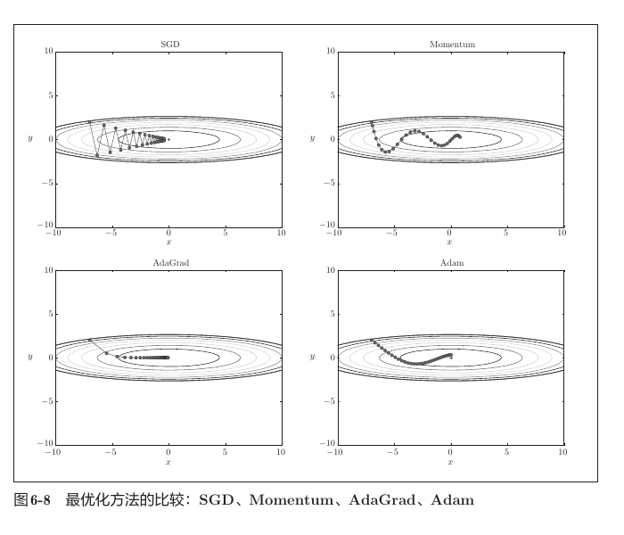
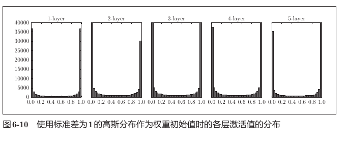
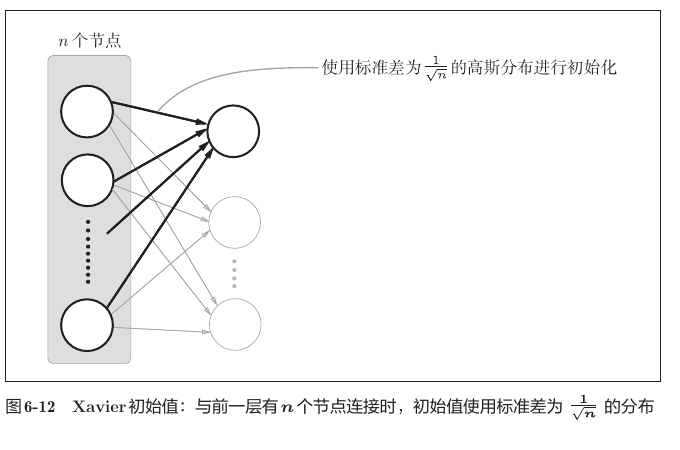
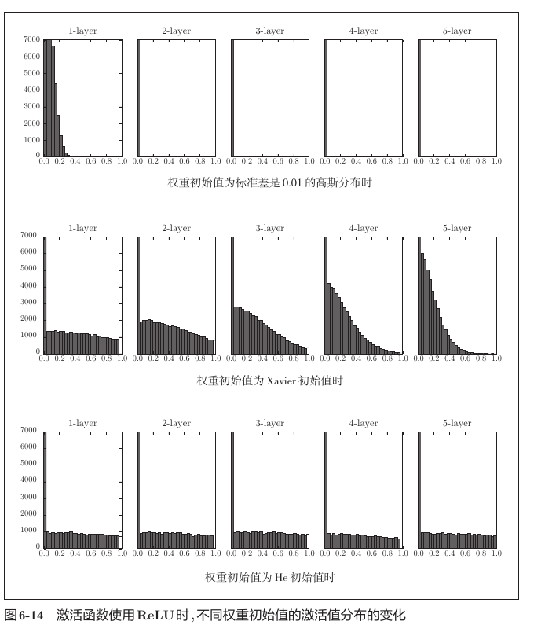
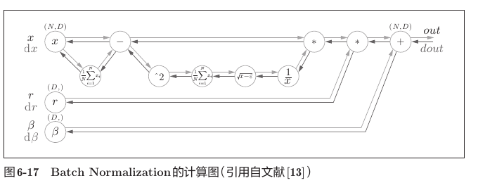
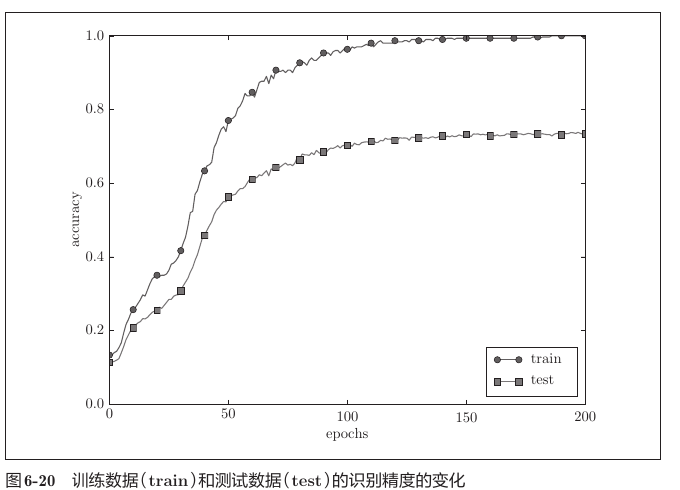
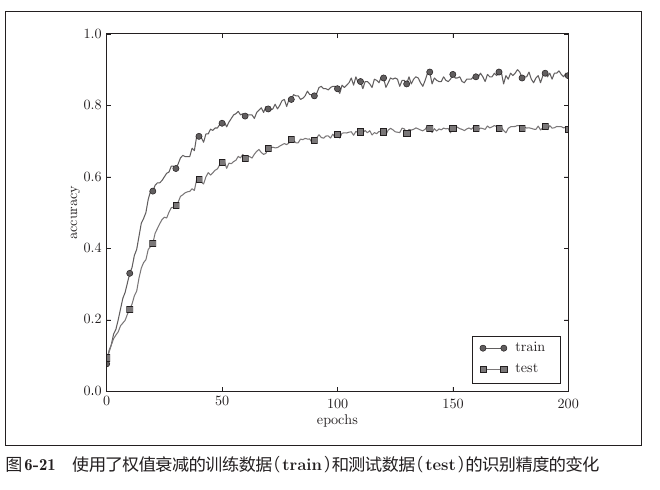
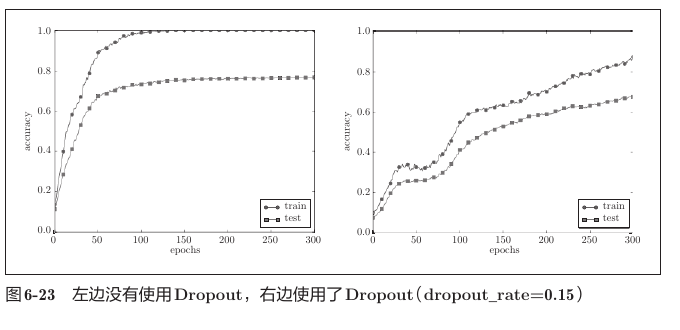
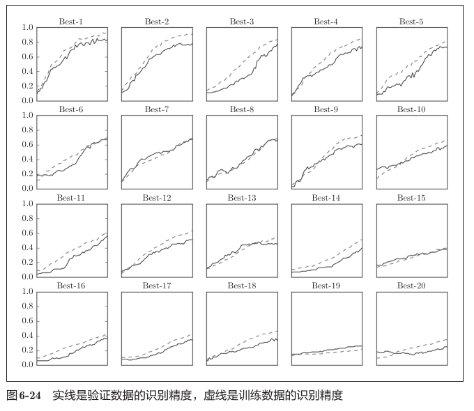

# 第六章 与学习相关的技巧

## 1. 本章核心

前两章已经解决了两个问题：

```text
第四章：神经网络怎样通过梯度下降学习参数
第五章：怎样通过反向传播高效计算梯度
```

第六章进一步研究：**怎样让神经网络学得更快、更稳定，并且对没有见过的数据也能保持良好表现。**

本章主线如下：

```text
选择参数更新方法
SGD / Momentum / AdaGrad / Adam
            ↓
让信号和梯度稳定传播
Xavier / He 初始化 / Batch Normalization
            ↓
抑制对训练数据的过度拟合
Weight Decay / Dropout
            ↓
用验证集选择学习率等超参数
随机搜索 → 缩小范围 → 再次搜索
```

必须掌握的结论：

- SGD 简单可靠，但在不同方向坡度差异很大时容易走“之”字形；
- Momentum 利用历史速度，使梯度方向稳定的轴加速、反复变号的轴相互抵消；
- AdaGrad 为每个参数保存梯度平方和，自动减小频繁变化参数的学习率；
- Adam 同时利用梯度的一阶矩和二阶矩，并进行偏差修正；
- 权重不能全部初始化为相同值，否则同一层神经元会一直进行相同的学习；
- Sigmoid、tanh 通常配合 Xavier 初始化，ReLU 通常配合 He 初始化；
- Batch Normalization 按 mini-batch、逐特征标准化，并通过 `gamma`、`beta` 恢复表达能力；
- 过拟合表现为训练准确率很高，但验证或测试准确率明显较低；
- 权值衰减通过惩罚过大的权重缓解过拟合；
- Dropout 训练时随机关闭神经元，反向传播必须使用同一个掩码；
- 超参数只能根据验证集调整，测试集应留到最后评估一次；
- 学习率和权值衰减系数通常在对数尺度上随机搜索。

---

## 2. 参数的更新

### 2.1 优化器负责什么

反向传播负责计算损失关于参数的梯度：

$$
g=\frac{\partial L}{\partial W}
$$

优化器负责根据梯度更新参数。`W` 和 `g` 的形状必须完全相同，例如：

```text
W1.shape  = (784, 100)
dW1.shape = (784, 100)

b1.shape  = (100,)
db1.shape = (100,)
```

在项目中，不同优化器都提供统一接口：

```python
optimizer.update(network.params, grads)
```

因此训练循环不需要知道每种更新公式的内部细节。

### 2.2 SGD

SGD 的更新公式为：

$$
W\leftarrow W-\eta g
$$

其中：

- `W` 是参数；
- `g` 是当前梯度；
- `eta` 是学习率。

```python
class SGD:
    def __init__(self, lr=0.01):
        self.lr = lr

    def update(self, params, grads):
        for key in params.keys():
            params[key] -= self.lr * grads[key]
```

SGD 每次只根据当前位置的梯度决定方向，不记得以前走过的路径。

对于等高线狭长、两个方向坡度差异很大的函数，陡峭方向的梯度很大，SGD 容易越过谷底并不断改变符号；平缓方向的梯度又很小，前进速度缓慢，因此形成“之”字形路径。

### 2.3 Momentum

Momentum 为每个参数增加一个同形状的速度变量 `v`：

$$
v\leftarrow \alpha v-\eta g
$$

$$
W\leftarrow W+v
$$

其中 `alpha` 通常取 `0.9` 左右。

```python
if self.v is None:
    self.v = {}
    for key, value in params.items():
        self.v[key] = np.zeros_like(value)

for key in params.keys():
    self.v[key] = self.momentum * self.v[key] - self.lr * grads[key]
    params[key] += self.v[key]
```

直观理解：

```text
某方向的梯度长期同号  → 速度不断累积 → 加速前进
某方向的梯度反复变号  → 正负更新抵消 → 减少来回振荡
```

所以 Momentum 能减少 SGD 在陡峭方向上的“之”字形摆动，并加快平缓方向上的移动。

### 2.4 AdaGrad

AdaGrad 为每个参数保存过去梯度平方的累积值：

$$
h\leftarrow h+g^2
$$

$$
W\leftarrow W-\eta\frac{g}{\sqrt{h}+\varepsilon}
$$

这里的平方、除法和开方都是逐元素运算，`h`、`g`、`W` 形状相同。

```python
self.h[key] += grads[key] * grads[key]
params[key] -= self.lr * grads[key] / (
    np.sqrt(self.h[key]) + 1e-7
)
```

某个参数过去的梯度越大、出现越频繁，它对应的 `h` 就越大，实际更新步幅就越小。

AdaGrad 的局限是 `h` 只增加、不减小。训练很久后，学习率可能衰减得过小，使参数几乎停止更新。RMSProp 的改进思路是只重点保留近期的梯度平方信息。

### 2.5 Adam

Adam 可以理解为：

```text
Momentum 的方向平滑
        +
RMSProp 的自适应步幅
        +
训练初期的偏差修正
```

它保存梯度的一阶矩 `m` 和二阶矩 `v`：

$$
m_t=\beta_1m_{t-1}+(1-\beta_1)g_t
$$

$$
v_t=\beta_2v_{t-1}+(1-\beta_2)g_t^2
$$

由于初始值都是零，训练初期的 `m`、`v` 会偏小，所以需要修正：

$$
\hat{m}_t=\frac{m_t}{1-\beta_1^t}
$$

$$
\hat{v}_t=\frac{v_t}{1-\beta_2^t}
$$

最后更新参数：

$$
W\leftarrow W-\eta\frac{\hat{m}_t}{\sqrt{\hat{v}_t}+\varepsilon}
$$

项目默认使用：

```text
learning_rate = 0.001
beta1         = 0.9
beta2         = 0.999
```

### 2.6 四种优化器的路径比较



复习这张图时重点看：

- SGD 在陡峭方向上来回振荡；
- Momentum 的路径仍有惯性，但整体更平滑；
- AdaGrad 会按照各方向过去的梯度大小调整步幅；
- Adam 同时利用方向的平滑和自适应学习率；
- 图中的结果依赖目标函数和超参数，不能据此断言某个优化器永远最好。

| 优化器 | 保存的状态 | 主要优点 | 主要注意点 |
|---|---|---|---|
| SGD | 无 | 简单、容易理解 | 容易振荡，收敛可能较慢 |
| Momentum | 速度 `v` | 减少振荡，沿稳定方向加速 | 多一个动量系数 |
| AdaGrad | 梯度平方和 `h` | 每个参数拥有不同步幅 | 长期训练可能过早停止 |
| Adam | `m`、`v`、迭代次数 | 收敛快，通常容易使用 | 仍需选择合适学习率 |

---

## 3. 权重的初始值

### 3.1 为什么不能把所有权重设为相同值

如果同一层的神经元拥有完全相同的权重，它们在相同输入下会得到相同输出；反向传播时又会得到相同梯度，因此更新后仍然相同。

```text
相同初值
   ↓
相同输出
   ↓
相同梯度
   ↓
相同更新
   ↓
神经元始终无法学习不同特征
```

所以权重需要随机初始化来打破对称性。这里“不可以相同”不只表示不能全为零，全部设成同一个非零值也有相同问题。偏置则可以初始化为零。

### 3.2 权重过大：Sigmoid 饱和

当权重标准差为 `1` 时，每个神经元会把大量输入加权求和，`a=xW` 容易变成很大的正数或负数。Sigmoid 输出于是集中到 `0` 和 `1` 附近。



Sigmoid 的导数是：

$$
\frac{\partial y}{\partial x}=y(1-y)
$$

当 `y` 接近 `0` 或 `1` 时，导数接近 `0`。反向传播连续乘上这些很小的导数后，前面层的梯度会越来越小，产生梯度消失。

### 3.3 权重过小也不行

如果所有权重的标准差都是 `0.01`，正向传播中的值会逐层缩小并集中到很窄的范围。

即使 ReLU 在正数区域的导数为 `1`，梯度仍然可能很小，因为：

```text
经过 Affine 反向传播：dx = dout · W转置
计算权重梯度：       dW = x转置 · dout
```

很小的 `W` 会缩小传给前面层的梯度，很小的激活值 `x` 也会使 `dW` 变小。因此参数几乎不更新。

### 3.4 Xavier 初始值

Xavier 初始值根据前一层输入节点数 `n` 调整标准差：

$$
\sigma=\sqrt{\frac{1}{n}}
$$



代码：

```python
scale = np.sqrt(1.0 / fan_in)
W = scale * np.random.randn(fan_in, fan_out)
```

例如：

```text
W1.shape = (784, 100) → fan_in = 784 → std ≈ 0.0357
W2.shape = (100, 100) → fan_in = 100 → std = 0.1
```

Xavier 的目标是让各层信号保持合适的尺度，通常用于 Sigmoid 或 tanh：

```text
Sigmoid / tanh → Xavier
```

### 3.5 He 初始值

He 初始值的标准差为：

$$
\sigma=\sqrt{\frac{2}{n}}
$$

代码：

```python
scale = np.sqrt(2.0 / fan_in)
W = scale * np.random.randn(fan_in, fan_out)
```

ReLU 会把负数区域变成零，因此使用比 Xavier 更大的尺度来保持信号的方差：

```text
ReLU → He
```



图中应该看出：

- `std=0.01` 时，激活值逐层缩小，后面层几乎全部集中在零附近；
- Xavier 能传播信号，但配合 ReLU 时分布会逐渐偏斜；
- He 使各层保持较稳定、较宽的激活分布，更适合 ReLU。

### 3.6 初始化方法速记

| 激活函数 | 推荐初始化 | 标准差 |
|---|---|---|
| Sigmoid | Xavier | `sqrt(1 / fan_in)` |
| tanh | Xavier | `sqrt(1 / fan_in)` |
| ReLU | He | `sqrt(2 / fan_in)` |

`fan_in` 是前一层输入节点数，不是当前层输出节点数。

---

## 4. Batch Normalization

### 4.1 要解决的问题

即使初始权重选择合适，参数在训练过程中仍会不断变化，各层输入分布也会随之变化。Batch Normalization（简称 Batch Norm 或 BN）在网络中主动调整数据分布，使训练更加稳定。

常见效果包括：

- 可以增大学习率，加快学习；
- 降低对权重初始值的敏感程度；
- 改善梯度传播；
- 在一定程度上抑制过拟合。

### 4.2 正向传播与形状

设一个 mini-batch 的输入为：

```text
X.shape = (N, D)
```

其中：

- `N`：批量大小；
- `D`：特征数，也就是这一层的神经元数。

例如：

```text
X.shape = (100, 100)
```

BN 对每一个特征沿批量方向分别计算统计量。

第一步，均值：

$$
\mu=\frac{1}{N}\sum_{i=1}^{N}x_i
$$

```python
mu = x.mean(axis=0)
```

形状：

```text
x.shape  = (N, D)
mu.shape = (D,)
```

第二步，方差：

$$
\sigma^2=\frac{1}{N}\sum_{i=1}^{N}(x_i-\mu)^2
$$

```python
xc = x - mu
var = np.mean(xc**2, axis=0)
```

形状：

```text
xc.shape  = (N, D)
var.shape = (D,)
```

第三步，标准化：

$$
\hat{x}=\frac{x-\mu}{\sqrt{\sigma^2+\varepsilon}}
$$

`epsilon` 防止方差为零时除以零。

```text
x_hat.shape = (N, D)
```

第四步，缩放和平移：

$$
y=\gamma\hat{x}+\beta
$$

```text
gamma.shape = (D,)
beta.shape  = (D,)
y.shape     = (N, D)
```

`gamma` 和 `beta` 是通过学习确定的参数。初始时通常：

```text
gamma = 1
beta  = 0
```

BN 并不是强迫所有层永远保持均值0、方差1；它先标准化，再让网络通过 `gamma`、`beta` 学习最合适的尺度和位置。

### 4.3 计算图



图中的形状关系非常重要：

```text
输入 x、输出 y、上游梯度 dout、下游梯度 dx：(N, D)
均值、方差、gamma、beta 及其梯度：        (D,)
```

因为 `gamma` 和 `beta` 对批量中的所有数据共用，所以反向传播时需要沿样本轴汇总：

```python
dbeta = np.sum(dout, axis=0)
dgamma = np.sum(x_hat * dout, axis=0)
```

### 4.4 训练模式和推理模式

BN 在训练和推理时的行为不同：

```text
训练模式：使用当前 mini-batch 的均值和方差，更新 running mean/var
推理模式：使用训练期间积累的 running mean/var
```

不能在推理时依赖当前输入批量的统计量，因为实际预测可能一次只有一条数据，而且预测结果不应该随着同批次其他样本变化。

项目中的层次顺序为：

```text
Affine → BatchNorm → ReLU → 下一层
```

---

## 5. 过拟合与正则化

### 5.1 什么是过拟合

过拟合是指模型过度适应训练数据，甚至记住了训练样本的偶然特征和噪声，导致对新数据的表现变差。

常见现象：

```text
训练准确率持续上升并接近100%
验证或测试准确率较低，甚至停止上升
两条曲线之间出现明显差距
```



容易产生过拟合的条件：

- 训练数据很少；
- 模型参数很多、表达能力很强；
- 训练时间过长；
- 数据存在噪声或训练集缺乏代表性。

本章代码只保留300条 MNIST 训练数据，同时使用6个隐藏层，每层100个神经元，就是为了故意制造过拟合。

### 5.2 权值衰减

L2 权值衰减在原损失上增加权重平方和：

$$
L=L_{data}+\frac{\lambda}{2}\sum W^2
$$

对权重求导后：

$$
\frac{\partial L}{\partial W}
=
\frac{\partial L_{data}}{\partial W}+\lambda W
$$

代码中必须同时做到两件事：

```python
# 计算损失时
weight_decay += 0.5 * weight_decay_lambda * np.sum(W**2)

# 计算梯度时
dW = affine_layer.dW + weight_decay_lambda * W
```

如果只把惩罚项加到损失里，却没有把 `lambda * W` 加到梯度里，参数更新就不会真正受到权值衰减影响。

通常只惩罚权重 `W`，不惩罚偏置 `b`。



与未使用权值衰减相比，训练准确率可能下降，但训练与测试准确率的差距缩小。这正是正则化的目标：不是尽量记住训练集，而是提高泛化能力。

`lambda` 也不能无限增大：

```text
lambda 太小 → 正则化效果不明显
lambda 合适 → 缓解过拟合
lambda 太大 → 参数受到过度限制，产生欠拟合
```

### 5.3 Dropout

Dropout 在训练时随机关闭一部分神经元：

```python
self.mask = (
    np.random.rand(*x.shape) > self.dropout_ratio
)
out = x * self.mask
```

假设：

```text
x.shape            = (100, 100)
mask.shape         = (100, 100)
dropout_ratio      = 0.2
平均保留概率         = 0.8
```

`mask` 中：

```text
True  → 激活值保留
False → 激活值变为0
```

每次正向传播都会生成新的随机掩码，相当于训练不同的子网络，使神经元不能长期依赖某些固定搭档。

反向传播必须复用正向传播的同一个掩码：

```python
dx = dout * self.mask
```

```text
正向被保留 → 梯度通过
正向被关闭 → 梯度为0
```

教材实现的推理模式为：

```python
return x * (1.0 - self.dropout_ratio)
```

也就是训练时不缩放、推理时乘保留概率。PyTorch 等现代框架通常使用 inverted dropout：训练时除以保留概率，推理时不缩放。两种方法不要混用。



左图没有 Dropout，训练准确率很快达到100%，但测试准确率明显较低；右图使用 Dropout 后学习变慢，训练准确率不再迅速达到100%，训练和测试曲线的差距缩小。

---

## 6. 超参数的验证

### 6.1 参数和超参数的区别

参数由训练数据和反向传播自动学习：

```text
权重 W
偏置 b
BatchNorm 的 gamma、beta
```

超参数由人设定或通过搜索选择：

```text
学习率
batch size
隐藏层数量
每层神经元数量
weight decay lambda
dropout ratio
```

### 6.2 为什么需要验证集

数据应划分为：

```text
训练集：用于计算梯度和更新参数
验证集：用于选择超参数和比较模型
测试集：所有选择完成后，只用于最终评价
```

如果根据测试集准确率反复修改学习率，就等于把测试集信息用于训练过程，最终测试准确率会变得过于乐观。

本章的过拟合示例为了直观展示效果，每个 epoch 都绘制了名为 `test` 的曲线；在正式项目中，应把这条用于比较和调参的曲线换成验证集，最后再用测试集做一次独立评价。

划分前必须把数据和标签按照同一个随机排列打乱：

```python
x_train, t_train = shuffle_dataset(x_train, t_train)

validation_num = int(
    x_train.shape[0] * validation_rate
)

x_val = x_train[:validation_num]
t_val = t_train[:validation_num]
x_train = x_train[validation_num:]
t_train = t_train[validation_num:]
```

切片下标必须是整数，因此 `validation_num` 要使用 `int()` 转换。

### 6.3 为什么在对数尺度上搜索

学习率等超参数的有效范围往往跨越多个数量级，例如：

```text
0.000001、0.00001、0.0001、0.001、0.01
```

所以应该随机搜索指数，而不是在线性区间中平均采样：

```python
weight_decay = 10 ** np.random.uniform(-8, -4)
lr = 10 ** np.random.uniform(-6, -2)
```

含义是：

```text
weight_decay：10^-8 ～ 10^-4
learning_rate：10^-6 ～ 10^-2
```

这种方式使每个数量级获得相近的采样机会。

### 6.4 随机搜索流程

```text
先指定较大的超参数范围
          ↓
随机抽取若干组合
          ↓
每个组合都重新创建并训练网络
          ↓
按验证集准确率排序
          ↓
观察较好组合所在的范围
          ↓
缩小范围并再次搜索
```



图中实线是验证准确率，虚线是训练准确率。重点不是寻找一次实验中排名第一的某个精确数值，而是找到“表现较好的超参数集中在哪个数量级”。

每组超参数实验都必须重新创建网络，不能让后一组接着前一组已经训练过的参数继续学习，否则比较不公平。

---

## 7. 本章训练代码的共同结构

本章虽然实验很多，但训练主线基本相同：

```python
batch_mask = np.random.choice(train_size, batch_size)
x_batch = x_train[batch_mask]
t_batch = t_train[batch_mask]

grads = network.gradient(x_batch, t_batch)
optimizer.update(network.params, grads)

loss = network.loss(x_batch, t_batch)
```

以 MNIST、`batch_size=100`、隐藏层宽度100为例：

```text
x_batch                 (100, 784)
t_batch                 (100,) 或 (100, 10)
        ↓
W1                      (784, 100)
Affine1 / ReLU / BN     (100, 100)
        ↓
中间隐藏层               (100, 100)
        ↓
最后一层权重              (100, 10)
分类得分                  (100, 10)
        ↓
SoftmaxWithLoss          标量
        ↓
所有梯度与对应参数同形状
```

`Trainer` 类把上面的过程封装为：

```text
train()
  └─ 重复调用 train_step()
       ├─ 抽取 mini-batch
       ├─ 计算梯度
       ├─ 更新参数
       ├─ 记录损失
       └─ 每个 epoch 记录训练/验证准确率
```

反向传播负责求梯度，优化器负责使用梯度更新参数，正则化负责限制模型，验证集负责选择超参数；四者职责不能混淆。

---

## 8. 本章代码与复习目标

| 文件 | 主要内容 | 复习时重点观察 |
|---|---|---|
| `optimizer_compare_naive.py` | 二维函数上的优化器比较 | 四种优化器的更新路径 |
| `optimizer_compare_mnist.py` | MNIST 优化器比较 | 相同 mini-batch 下损失下降速度 |
| `weight_init_activation_histogram.py` | 激活值直方图 | 初始化如何改变各层分布 |
| `weight_init_compare.py` | 三种初始化的训练比较 | `std=0.01`、Xavier、He 的差异 |
| `batch_norm_test.py` | BN 对权重尺度的鲁棒性 | 使用 BN 后是否更快、更稳定 |
| `batch_norm_gradient_check.py` | BN 梯度检查 | 数值梯度与反向传播梯度应接近 |
| `overfit_weight_decay.py` | L2 权值衰减 | 训练和测试准确率差距是否缩小 |
| `overfit_dropout.py` | Dropout | 训练变慢但过拟合是否缓解 |
| `hyperparameter_optimization.py` | 超参数随机搜索 | 验证集、对数采样和结果排序 |

---

## 9. 常见易错点

1. **把权重全部设为零。** 同一层神经元会得到相同梯度，无法打破对称性。
2. **认为 ReLU 导数为1就不会梯度消失。** 梯度还要经过很小的权重矩阵，`dW` 也受很小激活值影响。
3. **把 Xavier 和 He 混用。** Sigmoid、tanh 优先 Xavier，ReLU 优先 He。
4. **把 `fan_in` 理解成输出节点数。** `fan_in` 是权重矩阵第一维，即前一层输入节点数。
5. **BN 沿错误的轴计算均值。** 对 `(N, D)` 输入应沿 `axis=0` 逐特征统计。
6. **训练和推理都使用当前批量统计量。** BN 推理时应使用 running mean/variance。
7. **只把权值衰减加入 loss，忘记给 `dW` 加 `lambda * W`。** 这样参数更新不会受到正确惩罚。
8. **误以为 dropout ratio 是保留概率。** 教材中的 `dropout_ratio` 是删除概率。
9. **Dropout 反向传播重新生成 mask。** 必须复用本次正向传播的同一个 mask。
10. **混用教材 Dropout 和 inverted dropout 的缩放方式。** 二者只能选择一种完整实现。
11. **使用测试集反复调参。** 调参看验证集，测试集只用于最终评价。
12. **在线性尺度上搜索学习率。** 应使用 `10 ** uniform(a, b)` 进行对数尺度采样。
13. **不同超参数试验复用同一个已经训练过的网络。** 每次试验都必须重新初始化网络。
14. **认为某个优化器永远最好。** 优化器效果依赖问题、网络结构和超参数。

---

## 10. 复习速记

```text
SGD：       只看当前梯度
Momentum：  保存速度，减少振荡
AdaGrad：   累积梯度平方，逐参数调整步幅
Adam：      一阶矩 + 二阶矩 + 偏差修正

Sigmoid/tanh：Xavier，std = sqrt(1 / fan_in)
ReLU：        He，     std = sqrt(2 / fan_in)

BatchNorm：按特征标准化，再用 gamma、beta 缩放和平移
训练用 batch 统计量，推理用 running 统计量

Weight Decay：loss 加 (lambda / 2) * sum(W^2)
              dW 加 lambda * W

Dropout：训练时随机删除，反向传播复用 mask
         教材实现推理时乘保留概率

训练集：学参数
验证集：选超参数
测试集：最终评价
```

## 11. 本章一句话总结

> 高效可靠的深度学习训练，不仅要能算出梯度，还要用合适的优化器更新参数、用正确的初始化和 Batch Normalization 稳定信号、用权值衰减和 Dropout 控制过拟合，并用独立验证集选择超参数。

---

文中教材插图来自本仓库 `docs` 目录下的《深度学习入门：基于Python的理论与实现》PDF，仅用于个人学习与复习。
