# 第七章 卷积神经网络

## 1. 本章核心

前面的神经网络主要使用全连接层处理数据。第七章开始学习专门处理图像等空间数据的网络：**卷积神经网络（Convolutional Neural Network，CNN）**。

本章主线如下：

```text
图像保持为四维数据 (N, C, H, W)
              ↓
卷积层提取局部特征
              ↓
ReLU 引入非线性
              ↓
池化层缩小空间尺寸
              ↓
重复提取更抽象的特征
              ↓
全连接层完成最终分类
```

必须掌握的结论：

- CNN 不会一开始就把图像展平成一维，而是尽量保留通道、高度和宽度信息；
- 卷积层只观察局部区域，并让同一个滤波器在整张图像上重复使用；
- 输入通道数必须与每个滤波器的通道数一致；
- 一个滤波器生成一张输出特征图，`FN` 个滤波器生成 `FN` 个输出通道；
- 卷积层输入形状为 `(N, C, H, W)`，权重形状为 `(FN, C, FH, FW)`，输出形状为 `(N, FN, OH, OW)`；
- `im2col` 将卷积转换为二维矩阵乘法，使 NumPy 可以高效计算；
- 卷积结果先排列成 `(N, OH, OW, FN)`，必须再通过 `transpose(0, 3, 1, 2)` 变为 `(N, FN, OH, OW)`；
- 池化层没有需要学习的参数，并且不会改变通道数；
- 最大池化反向传播时，只把梯度传给正向传播中取得最大值的位置；
- 浅层卷积层通常学习边缘、斑块等低级特征，越深的层学习越抽象的特征。

---

## 2. 为什么图像适合使用 CNN

### 2.1 全连接层的问题

MNIST 的一张图像原本具有下面的空间结构：

```text
(通道数, 高度, 宽度) = (1, 28, 28)
```

普通全连接网络会先把它展平：

```text
(1, 28, 28) → (784,)
```

展平后，网络只看到784个排列起来的数，无法直接知道：

- 哪些像素在上下方向相邻；
- 哪些像素在左右方向相邻；
- 某个局部区域能否构成边缘或纹理；
- 同一种图案出现在图像不同位置时，它们是否属于同一种特征。

CNN 与全连接网络的结构对比如下：

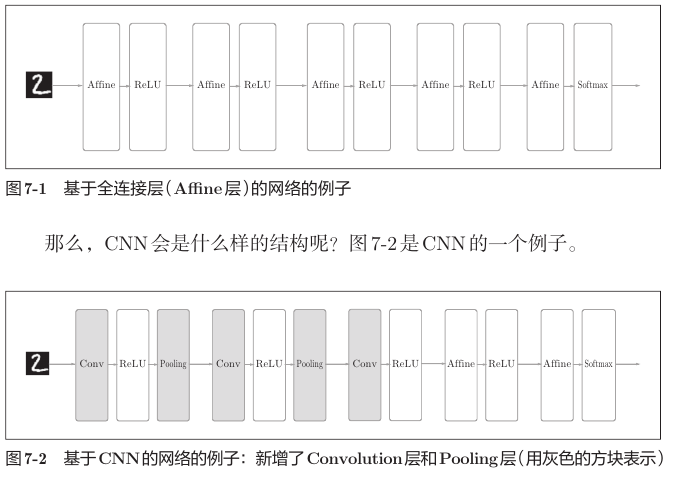

CNN 常见的基本结构是：

```text
Conv → ReLU → Pooling → Conv → ReLU → Pooling → … → Affine → Softmax
```

卷积层和池化层负责提取空间特征，后面的全连接层负责根据这些特征完成分类。

### 2.2 卷积层的三个重要特点

#### 局部连接

滤波器只观察输入的一小块区域。例如，`5 × 5` 滤波器每次只处理一个 `5 × 5` 的局部窗口。

#### 权重共享

同一个滤波器会在整张图像上滑动。无论某条边缘位于图像左侧还是右侧，都由同一组权重检测。

#### 保持空间形状

卷积层的输入和输出都保留通道、高度、宽度，因此后续层仍然能利用位置关系。

相比之下，若将 `28 × 28` 的图像直接连接到100个神经元，需要：

```text
784 × 100 = 78,400 个权重
```

而30个 `5 × 5` 单通道滤波器只包含：

```text
30 × 1 × 5 × 5 = 750 个权重
```

这两个结构的输出并不完全相同，但这个对比能说明：**局部连接和权重共享可以显著减少重复参数。**

---

## 3. 卷积运算

### 3.1 卷积做了什么

二维单通道卷积的基本过程如下：

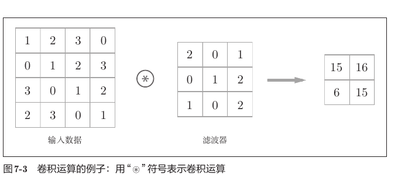

每到一个位置，都执行三步：

1. 取出与滤波器同样大小的输入局部区域；
2. 对局部区域和滤波器逐元素相乘；
3. 把全部乘积相加，并加上偏置。

对输出位置 `(i, j)`，可以写成：

$$
y_{i,j}=\sum_c\sum_u\sum_v x_{c,iS+u-P,jS+v-P}w_{c,u,v}+b
$$

其中：

- `c` 遍历输入通道；
- `u、v` 遍历滤波器的高和宽；
- `S` 是步幅；
- `P` 是填充大小；
- `b` 是当前滤波器对应的偏置。

卷积在深度学习教材中通常采用互相关形式，即滤波器不进行数学卷积中的180度翻转。只要正向和反向传播采用同一约定，不会影响网络学习。

### 3.2 填充（padding）

填充是在输入边缘周围补值，通常补0：

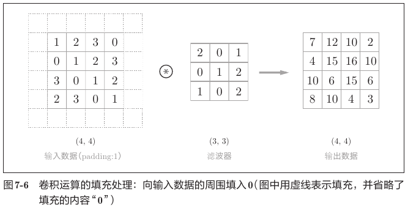

填充的主要作用：

- 调整输出的高度和宽度；
- 避免每经过一层卷积，空间尺寸都迅速缩小；
- 让图像边缘的信息有更多机会参与计算。

当步幅为1、滤波器大小为奇数时，要保持输入和输出尺寸相同，可以使用：

$$
P=\frac{F-1}{2}
$$

例如，`3 × 3` 滤波器使用 `pad=1`，`5 × 5` 滤波器使用 `pad=2`。

### 3.3 步幅（stride）

步幅表示滤波器每次移动多少格：

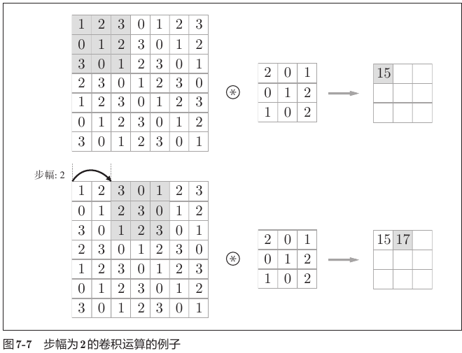

- `stride=1`：每次移动1格，输出较大；
- `stride=2`：每次移动2格，输出较小；
- 步幅越大，采样越稀疏，空间尺寸缩小得越快。

### 3.4 输出尺寸公式

设输入空间尺寸为 `(H, W)`，滤波器尺寸为 `(FH, FW)`，填充为 `P`，步幅为 `S`，则：

$$
OH=1+\frac{H+2P-FH}{S}
$$

$$
OW=1+\frac{W+2P-FW}{S}
$$

程序中对应：

```python
out_h = int(1 + (H + 2 * pad - FH) / stride)
out_w = int(1 + (W + 2 * pad - FW) / stride)
```

虽然代码使用 `int()`，但不能依靠它随意截断小数。卷积参数应使输出尺寸本来就是整数。

例如：

```text
H = W = 28
FH = FW = 5
P = 0
S = 1

OH = OW = 1 + (28 - 5) / 1 = 24
```

### 3.5 多通道与多个滤波器

彩色图像等输入具有多个通道。一个滤波器必须覆盖输入的全部通道：

```text
输入：    (C, H, W)
一个滤波器：(C, FH, FW)
```

输入通道数 `C` 与滤波器通道数必须相同，否则无法逐元素相乘并求和。

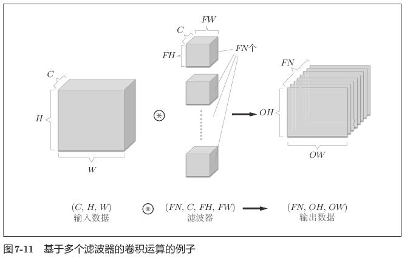

设滤波器数量为 `FN`：

```text
输入数据    (C, H, W)
滤波器权重  (FN, C, FH, FW)
偏置        (FN,)
输出数据    (FN, OH, OW)
```

关键关系：

```text
一个滤波器 → 一张特征图 → 一个输出通道
FN个滤波器 → FN张特征图 → FN个输出通道
```

偏置只有 `(FN,)` 个元素。每个滤波器有一个偏置，这个偏置会广播到该滤波器输出特征图的所有空间位置。

### 3.6 批量卷积的完整形状

批量处理时，在最前面增加批量轴 `N`：

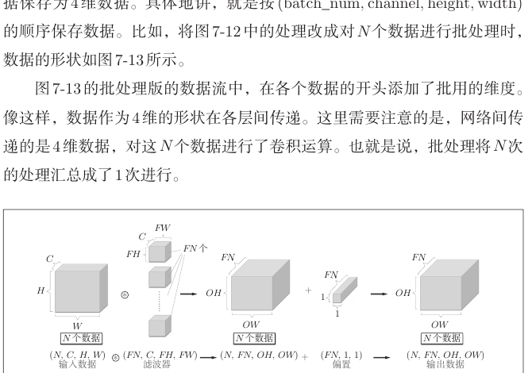

```text
输入 x       (N, C, H, W)
权重 W       (FN, C, FH, FW)
偏置 b       (FN,)
输出 out     (N, FN, OH, OW)
```

可以把完整关系记为：

```text
(N, C, H, W) * (FN, C, FH, FW) + (FN,)
                    ↓
             (N, FN, OH, OW)
```

这里的 `*` 表示卷积运算，不是普通的 NumPy 逐元素乘法。

---

## 4. 池化层

### 4.1 最大池化

池化层在一个局部窗口内选择代表值。教材主要使用最大池化：

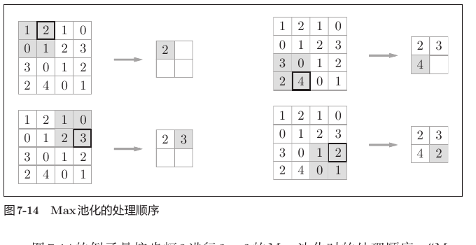

例如 `2 × 2` 最大池化会从每个 `2 × 2` 区域中取最大值：

```text
1  2
0  1    → 2
```

常见设置是池化窗口大小与步幅相同：

```python
Pooling(pool_h=2, pool_w=2, stride=2)
```

此时高度和宽度大约缩小一半。

### 4.2 池化层的特点

- 没有权重和偏置，因此没有需要学习的参数；
- 对每个通道独立处理，不会混合不同通道；
- 输入通道数与输出通道数相同；
- 可以缩小特征图，减少后续计算量；
- 对微小的位置变化具有一定鲁棒性。

形状变化为：

```text
输入  (N, C, H, W)
输出  (N, C, OH, OW)
```

注意，池化只改变 `H、W`，不会把 `C` 变成滤波器数量，因为池化层根本没有滤波器组。

### 4.3 最大池化的反向传播

正向传播时，一个池化窗口只保留最大值；反向传播时，梯度也只传给当时取得最大值的位置，其余位置为0。

```text
正向：窗口最大值位于第3个元素

反向：dout → [0, 0, dout, 0]
```

因此必须在正向传播时保存最大值的位置 `arg_max`，供反向传播使用。

---

## 5. 使用 `im2col` 实现卷积层

### 5.1 为什么需要 `im2col`

直接实现卷积需要多层 Python `for` 循环：

```text
批量 → 滤波器 → 输出高度 → 输出宽度 → 通道 → 滤波器内部
```

这种写法直观但速度较慢。`im2col` 的思路是：

> 把每个卷积窗口展开为一行，把卷积运算变成一次大型矩阵乘法。

`im2col` 是 **image to column** 的缩写。

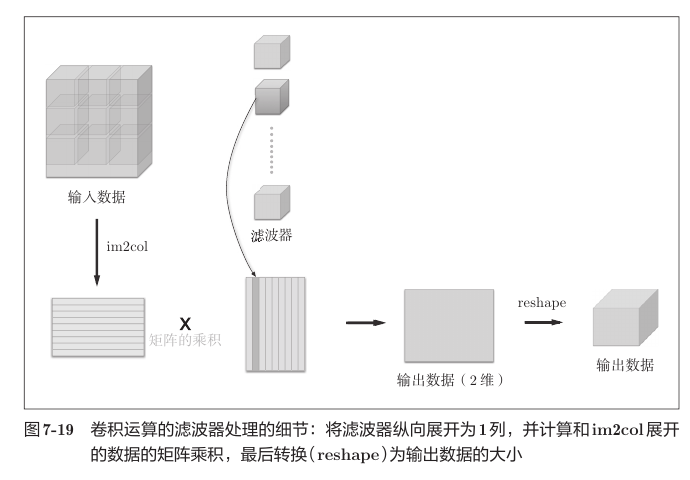

### 5.2 `im2col` 前后的形状

输入：

```text
x.shape = (N, C, H, W)
```

每个卷积窗口包含：

```text
C × FH × FW 个元素
```

每张图像共有：

```text
OH × OW 个窗口
```

因此展开结果为：

```text
col.shape = (N × OH × OW, C × FH × FW)
```

这两个维度的含义非常重要：

- 每一行：某一张图像在某一个空间位置上的完整卷积窗口；
- 每一列：该窗口中某个通道、某个高度和某个宽度位置的元素。

例如，输入为 `(1, 3, 7, 7)`，滤波器为 `5 × 5`，步幅1、填充0：

```text
OH = OW = 3
窗口数量 = 1 × 3 × 3 = 9
每个窗口元素数 = 3 × 5 × 5 = 75

col.shape = (9, 75)
```

若批量大小变成10：

```text
col.shape = (10 × 3 × 3, 75) = (90, 75)
```

相邻卷积窗口通常会重叠，所以 `im2col` 生成的矩阵中会出现重复元素。这会消耗更多内存，但换来了高度优化的矩阵乘法速度。

### 5.3 滤波器的展开

原始卷积权重：

```text
W.shape = (FN, C, FH, FW)
```

代码：

```python
col_W = self.W.reshape(FN, -1).T
```

分两步理解：

```text
W.reshape(FN, -1)
(FN, C, FH, FW) → (FN, C × FH × FW)

.T
(FN, C × FH × FW) → (C × FH × FW, FN)
```

因此：

```text
col_W.shape = (C × FH × FW, FN)
```

矩阵乘法的公共维度正好都是 `C × FH × FW`。

### 5.4 卷积矩阵乘法前后的变化

卷积层核心代码：

```python
col = im2col(x, FH, FW, self.stride, self.pad)
col_W = self.W.reshape(FN, -1).T
out = np.dot(col, col_W) + self.b
```

形状为：

```text
col                         col_W                         out
(N×OH×OW, C×FH×FW)    @    (C×FH×FW, FN)       =        (N×OH×OW, FN)
```

矩阵乘法后：

- `out` 的每一行对应某张图像的某一个输出位置；
- `out` 的每一列对应某一个滤波器；
- 所以每行包含这个位置被全部 `FN` 个滤波器处理后的结果。

以 SimpleConvNet 的一个100张图像批量为例：

```text
x       (100, 1, 28, 28)
W1      (30, 1, 5, 5)
OH=OW   24

col     (100×24×24, 1×5×5) = (57,600, 25)
col_W   (25, 30)
out     (57,600, 30)
```

### 5.5 为什么还要 `reshape` 和 `transpose`

矩阵乘法结果 `(N × OH × OW, FN)` 是二维矩阵，而 CNN 约定输出是四维数组 `(N, FN, OH, OW)`。

代码：

```python
out = out.reshape(N, out_h, out_w, -1).transpose(0, 3, 1, 2)
```

第一步：恢复批量和空间位置。

```text
(N × OH × OW, FN)
        ↓ reshape
(N, OH, OW, FN)
```

第二步：调整轴的顺序。

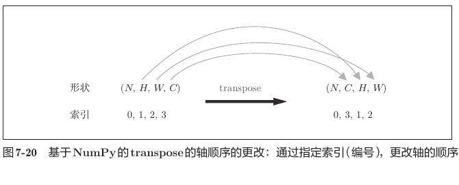

```text
(N, OH, OW, FN)
轴索引 0   1   2   3
        ↓ transpose(0, 3, 1, 2)
(N, FN, OH, OW)
轴索引 0   3   1   2
```

不能直接写成：

```python
out.reshape(N, FN, OH, OW)
```

原因是 `reshape` 只改变查看数据的形状，不会按照“滤波器轴”重新搬运元素。当前内存顺序是：对某个空间位置连续保存 `FN` 个滤波器结果。直接 `reshape` 会把这些数错误地解释为同一通道内连续的空间位置。

`transpose` 才是真正按指定的轴含义重新排列数据。

### 5.6 卷积层完整正向传播

```python
def forward(self, x):
    FN, C, FH, FW = self.W.shape
    N, C, H, W = x.shape

    out_h = int(1 + (H + 2 * self.pad - FH) / self.stride)
    out_w = int(1 + (W + 2 * self.pad - FW) / self.stride)

    col = im2col(x, FH, FW, self.stride, self.pad)
    col_W = self.W.reshape(FN, -1).T

    out = np.dot(col, col_W) + self.b
    out = out.reshape(N, out_h, out_w, -1).transpose(0, 3, 1, 2)

    self.x = x
    self.col = col
    self.col_W = col_W

    return out
```

保存 `x、col、col_W` 是为了反向传播时复用正向传播的中间结果。

### 5.7 卷积层反向传播的形状

设上游梯度为：

```text
dout.shape = (N, FN, OH, OW)
```

先还原为与正向矩阵乘法输出相同的二维排列：

```python
dout = dout.transpose(0, 2, 3, 1).reshape(-1, FN)
```

```text
(N, FN, OH, OW)
      ↓ transpose
(N, OH, OW, FN)
      ↓ reshape
(N × OH × OW, FN)
```

偏置梯度：

```python
self.db = np.sum(dout, axis=0)
```

```text
dout  (N × OH × OW, FN)
db    (FN,)
```

同一滤波器的偏置被加到所有图像和所有空间位置，所以反向传播时要把这些位置的梯度全部汇总。

权重梯度：

```python
self.dW = np.dot(self.col.T, dout)
self.dW = self.dW.transpose(1, 0).reshape(FN, C, FH, FW)
```

```text
col.T  (C×FH×FW, N×OH×OW)
dout   (N×OH×OW, FN)
                         ↓
dW二维  (C×FH×FW, FN)
                         ↓ transpose + reshape
dW      (FN, C, FH, FW)
```

最终 `dW.shape` 与 `W.shape` 完全相同。

输入梯度先在展开空间计算：

```python
dcol = np.dot(dout, self.col_W.T)
dx = col2im(dcol, self.x.shape, FH, FW, self.stride, self.pad)
```

```text
dout       (N×OH×OW, FN)
col_W.T    (FN, C×FH×FW)
dcol       (N×OH×OW, C×FH×FW)
dx         (N, C, H, W)
```

`col2im` 是 `im2col` 对应的逆向处理。因为相邻窗口可能重叠，同一个输入元素可能接收多个窗口传来的梯度，所以 `col2im` 会把重叠位置的梯度相加。

### 5.8 使用 `im2col` 实现池化

池化层也可以使用相同思路：

```text
1. im2col 展开池化窗口
2. 让每一行只包含一个池化窗口
3. 沿每一行取最大值
4. reshape + transpose 恢复四维输出
```

假设输入为 `(N, C, H, W)`：

```text
im2col后             (N×OH×OW, C×PH×PW)
按通道拆分窗口后      (N×OH×OW×C, PH×PW)
每行取最大值后        (N×OH×OW×C,)
恢复四维后            (N, C, OH, OW)
```

池化和卷积的共同点是都在局部窗口上操作；不同点是池化没有滤波器权重，也不会混合通道。

---

## 6. SimpleConvNet 的实现

### 6.1 网络结构

本章实现的简单 CNN 如下：

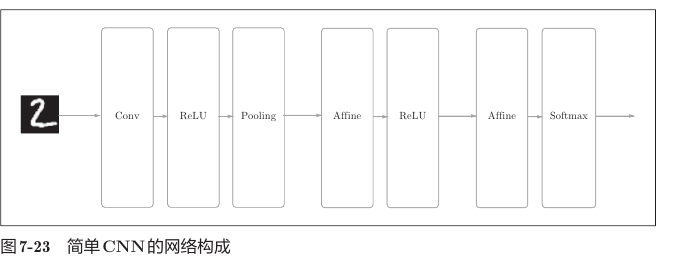

```text
输入
 ↓
Convolution → ReLU → Pooling
 ↓
Affine → ReLU
 ↓
Affine → SoftmaxWithLoss
```

`SimpleConvNet` 使用 `OrderedDict` 按顺序保存中间层：

```python
self.layers['Conv1'] = Convolution(...)
self.layers['Relu1'] = Relu()
self.layers['Pool1'] = Pooling(pool_h=2, pool_w=2, stride=2)
self.layers['Affine1'] = Affine(...)
self.layers['Relu2'] = Relu()
self.layers['Affine2'] = Affine(...)

self.last_layer = SoftmaxWithLoss()
```

### 6.2 默认参数下的完整形状变化

默认设置：

```text
input_dim    = (1, 28, 28)
filter_num   = 30
filter_size  = 5
pad          = 0
stride       = 1
hidden_size  = 100
output_size  = 10
```

卷积输出尺寸：

$$
OH=OW=1+\frac{28-5}{1}=24
$$

池化后尺寸：

```text
24 / 2 = 12
```

完整数据流：

```text
x                      (N, 1, 28, 28)
        ↓ Convolution
W1                     (30, 1, 5, 5)
b1                     (30,)
卷积输出                (N, 30, 24, 24)
        ↓ ReLU
                       (N, 30, 24, 24)
        ↓ 2×2 Pooling, stride=2
                       (N, 30, 12, 12)
        ↓ flatten（在 Affine 内部完成）
                       (N, 4320)
        ↓ Affine1
W2                     (4320, 100)
b2                     (100,)
                       (N, 100)
        ↓ ReLU
                       (N, 100)
        ↓ Affine2
W3                     (100, 10)
b3                     (10,)
分类得分                 (N, 10)
        ↓ SoftmaxWithLoss
损失                    标量
```

其中：

```text
pool_output_size = 30 × 12 × 12 = 4320
```

代码中的公式：

```python
pool_output_size = int(
    filter_num
    * (conv_output_size / 2)
    * (conv_output_size / 2)
)
```

这里的 `/ 2` 来自池化层使用 `2 × 2` 窗口和 `stride=2`。如果池化参数改变，这个公式也必须相应改变，不能永远固定除以2。

### 6.3 参数和梯度必须同形

| 参数 | 形状 | 对应梯度 | 梯度形状 |
|---|---:|---|---:|
| `W1` | `(30, 1, 5, 5)` | `dW1` | `(30, 1, 5, 5)` |
| `b1` | `(30,)` | `db1` | `(30,)` |
| `W2` | `(4320, 100)` | `dW2` | `(4320, 100)` |
| `b2` | `(100,)` | `db2` | `(100,)` |
| `W3` | `(100, 10)` | `dW3` | `(100, 10)` |
| `b3` | `(10,)` | `db3` | `(10,)` |

参数更新时才能逐元素相减：

```python
params[key] -= learning_rate * grads[key]
```

### 6.4 正向传播与反向传播

正向传播依次调用各层：

```python
def predict(self, x):
    for layer in self.layers.values():
        x = layer.forward(x)
    return x
```

反向传播将层顺序反转：

```python
layers = list(self.layers.values())
layers.reverse()

for layer in layers:
    dout = layer.backward(dout)
```

```text
正向：Conv1 → Relu1 → Pool1 → Affine1 → Relu2 → Affine2
反向：Affine2 → Relu2 → Affine1 → Pool1 → Relu1 → Conv1
```

最后从各个含参数的层中收集梯度：

```python
grads['W1'], grads['b1'] = self.layers['Conv1'].dW, self.layers['Conv1'].db
grads['W2'], grads['b2'] = self.layers['Affine1'].dW, self.layers['Affine1'].db
grads['W3'], grads['b3'] = self.layers['Affine2'].dW, self.layers['Affine2'].db
```

### 6.5 梯度检查

`gradient_check.py` 使用同一份输入比较：

```text
数值梯度 network.numerical_gradient(X, T)
反向传播 network.gradient(X, T)
```

比较方式：

```python
diff = np.abs(grad_num[key] - grad[key]).mean()
```

差值应非常小。数值梯度速度很慢，但实现简单、可信度较高；反向传播速度快，但代码更容易写错。二者接近，说明卷积网络的反向传播实现大概率正确。

随机输入没有“真实图片类别”，但梯度检查不需要标签具备现实语义。`T=[[1]]` 只是人为指定该样本的类别索引为1，目的仅是构造一个可计算的损失函数，让两种方法在相同条件下求导并比较。

### 6.6 训练脚本中的设置

`train_convnet.py` 保留了较少的数据以缩短学习时间：

```python
x_train, t_train = x_train[:5000], t_train[:5000]
x_test, t_test = x_test[:1000], t_test[:1000]
```

因此训练结果不能直接与使用完整 MNIST 数据集的教材结果比较。

训练器设置：

```python
Trainer(
    epochs=20,
    mini_batch_size=100,
    optimizer='Adam',
    optimizer_param={'lr': 0.001},
    evaluate_sample_num_per_epoch=1000
)
```

`evaluate_sample_num_per_epoch=1000` 表示每个 epoch 评估准确率时，只抽取前1000个训练样本和1000个测试样本进行计算。它只控制评估规模，不会把实际训练集自动改成1000个样本。

### 6.7 参数保存和读取

保存参数：

```python
with open(file_name, 'wb') as file:
    pickle.dump(params, file)
```

读取参数：

```python
with open(file_name, 'rb') as file:
    params = pickle.load(file)
```

读取后不仅要更新 `self.params`，还要把新数组重新绑定到各层：

```python
self.layers['Conv1'].W = self.params['W1']
self.layers['Affine1'].W = self.params['W2']
self.layers['Affine2'].W = self.params['W3']
```

否则字典已经是新参数，而层对象内部仍可能引用旧数组。

---

## 7. 卷积层学到了什么

### 7.1 第一层滤波器

学习前的滤波器是随机噪声，学习后会形成有规律的明暗结构：

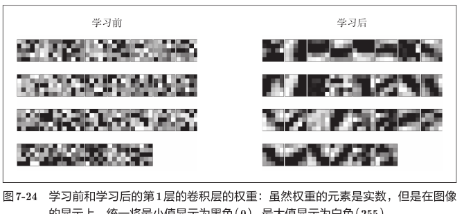

这些模式不是人工规定的，而是网络为了降低分类损失自动学习得到的。

不同滤波器会对不同图像模式产生较强响应，例如：

- 垂直边缘；
- 水平边缘；
- 斜向边缘；
- 明暗交界；
- 局部斑块。

### 7.2 滤波器响应

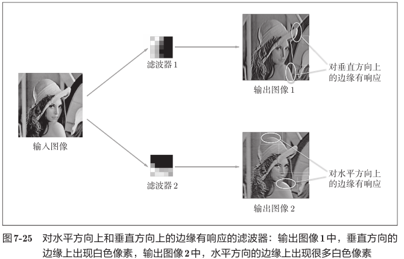

如果一个滤波器擅长检测垂直边缘，那么在输入图像出现垂直明暗变化的位置，输出特征图会出现较强响应。

项目中的 `apply_filter.py` 将一个滤波器单独作用于灰度图像：

```text
输入图像 img           (H, W)
加入批量和通道轴        (1, 1, H, W)

一个滤波器 w           (1, 5, 5)
加入滤波器数量轴        (1, 1, 5, 5)

卷积输出                (1, 1, H-4, W-4)
绘图前去掉单例轴        (H-4, W-4)
```

当 `pad=0、stride=1` 时，`5 × 5` 卷积会使高度和宽度各减少4。

为了单独观察滤波器的模式，实验中令：

```python
b = 0
```

这样输出只反映滤波器权重与图像局部区域的匹配程度，不受偏置整体平移影响。

### 7.3 越深的层学习越抽象的特征

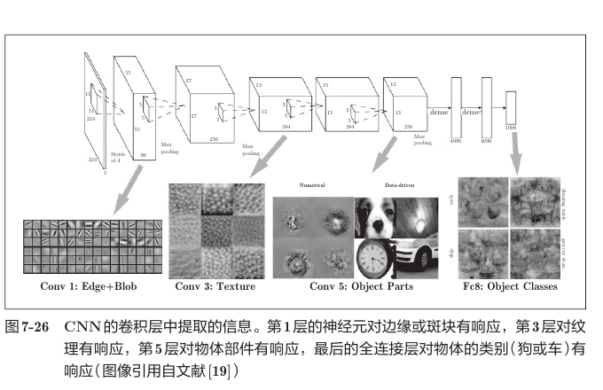

典型特征层次可以理解为：

```text
浅层：边缘、颜色、斑块
  ↓
中层：纹理、重复图案
  ↓
深层：物体的局部组成部分
  ↓
输出层：完整物体类别
```

原因是深层神经元的感受野更大。它们接收由前面多个局部特征组合而成的信息，因此能够表示更复杂、更抽象的模式。

---

## 8. 具有代表性的 CNN

### 8.1 LeNet

LeNet 是较早用于手写数字识别的 CNN，基本结构已经包含：

```text
卷积层 → 子采样层 → 卷积层 → 子采样层 → 全连接层
```

它与现代 CNN 的主要差异包括：

- 主要使用 Sigmoid；
- 使用子采样缩小尺寸；
- 网络规模较小；
- 面向当时较小的数据和计算资源。

### 8.2 AlexNet

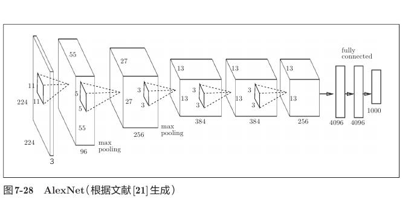

AlexNet 的基本结构与 LeNet 并非完全不同，但它结合了更适合深层网络训练的技术：

- 使用 ReLU 激活函数；
- 使用 Dropout 抑制过拟合；
- 使用局部响应归一化（LRN）；
- 借助 GPU、大规模数据和更强算力训练更大的模型。

AlexNet 在2012年的图像识别竞赛中取得突出成绩，成为深度学习重新受到广泛关注的重要节点。

### 8.3 两者带来的启示

| 对比项 | LeNet | AlexNet |
|---|---|---|
| 代表时期 | 早期 CNN | 深度学习快速发展时期 |
| 典型激活函数 | Sigmoid | ReLU |
| 网络规模 | 较小 | 更深、更宽 |
| 防止过拟合 | 较少使用现代正则化 | Dropout 等 |
| 计算条件 | CPU、小规模数据 | GPU、大规模数据 |

网络思想的发展不仅来自结构本身，也与激活函数、正则化方法、数据规模和硬件性能密切相关。

---

## 9. 本章代码与复习目标

| 文件 | 主要内容 | 复习时重点观察 |
|---|---|---|
| `simple_convnet.py` | SimpleConvNet 的定义 | 各层顺序、参数形状、正向与反向传播 |
| `train_convnet.py` | MNIST 卷积网络训练 | 四维输入、Trainer 设置、参数保存 |
| `gradient_check.py` | 卷积网络梯度检查 | 数值梯度与反向传播梯度的平均差 |
| `visualize_filter.py` | 显示学习前后的卷积核 | `W1` 的 `(FN, C, FH, FW)` 结构 |
| `apply_filter.py` | 将已学习滤波器作用于灰度图 | 单个滤波器和图像的形状变化 |
| `params.pkl` | 训练后的模型参数 | 使用 `pickle` 保存和载入参数 |
| `common/layers.py` | Convolution、Pooling 层 | `im2col`、`col2im`、反向传播 |
| `common/util.py` | `im2col` 与 `col2im` | 四维数据和二维矩阵的转换 |

---

## 10. 常见易错点

1. **把输入通道 `C` 当成滤波器数量 `FN`。** `C` 来自输入，`FN` 决定输出通道数，二者含义不同。
2. **滤波器通道数与输入通道数不同。** 输入 `(N, C, H, W)` 必须搭配权重 `(FN, C, FH, FW)`。
3. **把卷积权重写成三维。** 批量滤波器权重必须有 `FN` 轴，是四维数组。
4. **输出尺寸不是整数仍用 `int()` 强行截断。** 应重新检查 `H、W、FH、FW、pad、stride`。
5. **认为一个滤波器产生 `C` 个输出通道。** 一个滤波器会跨全部输入通道求和，最终只产生一个输出通道。
6. **把偏置写成 `(C,)`。** 卷积层每个输出滤波器对应一个偏置，所以应为 `(FN,)`。
7. **直接把二维矩阵结果 `reshape(N, FN, OH, OW)`。** 数据顺序不符合 NCHW，必须先恢复 `(N, OH, OW, FN)` 再 `transpose(0, 3, 1, 2)`。
8. **认为 `transpose` 只是改变显示方式。** 它重排轴的含义；这一步决定每个元素属于哪个通道和空间位置。
9. **忘记 `im2col` 会复制重叠区域。** 它速度快但会增加内存消耗。
10. **卷积反向传播直接把 `dcol` reshape 回输入。** 重叠窗口的梯度需要累加，应使用 `col2im`。
11. **认为池化会改变通道数。** 池化逐通道处理，输入和输出的 `C` 相同。
12. **给池化层设置可学习权重。** 最大池化只取最大值，没有权重和偏置。
13. **最大池化反向传播把梯度平均分给整个窗口。** 梯度只传给正向传播时最大值所在的位置。
14. **把 `np.zeros(filter_num)` 与 `np.zeros_like(filter_num)` 当成相同。** 前者创建长度为 `filter_num` 的数组；如果 `filter_num` 是一个整数，后者只创建一个与该整数同形的零标量。针对滤波器偏置应使用 `np.zeros(filter_num)`。
15. **混淆 `np.random.rand` 和 `np.random.randn`。** 前者服从 `[0,1)` 均匀分布，后者服从标准正态分布。
16. **使用 `fig.add_subfigure(ny, nx, i+1)`。** 绘制网格中的单幅子图应使用 `fig.add_subplot(ny, nx, i+1)`。
17. **从错误的工作目录运行可视化脚本。** `params.pkl` 和 `../dataset/lena_gray.png` 是相对路径，当前工作目录会影响文件能否找到。
18. **认为随机输入的标签必须由图像内容推断。** 梯度检查只需要一个人为标签来构造损失，不是在评价随机噪声的识别正确率。
19. **用数值梯度正式训练 CNN。** 数值梯度要逐元素扰动大量权重，速度极慢；训练必须使用反向传播梯度。
20. **把减少数据后的准确率与教材完整实验直接比较。** 数据量、训练轮数、随机初始化和评估样本数不同，结果自然不同。

---

## 11. 形状复习速记

```text
符号：
N   批量大小
C   输入通道数
H,W 输入高度、宽度
FN  滤波器数量，也就是输出通道数
FH,FW 滤波器高度、宽度
OH,OW 输出高度、宽度

卷积：
x       (N, C, H, W)
W       (FN, C, FH, FW)
b       (FN,)
out     (N, FN, OH, OW)

im2col：
col     (N×OH×OW, C×FH×FW)
col_W   (C×FH×FW, FN)
dot     (N×OH×OW, FN)
reshape (N, OH, OW, FN)
transpose
out     (N, FN, OH, OW)

池化：
输入     (N, C, H, W)
输出     (N, C, OH, OW)

SimpleConvNet：
(N,1,28,28)
→ (N,30,24,24)
→ (N,30,12,12)
→ (N,4320)
→ (N,100)
→ (N,10)
→ 标量损失
```

## 12. 自我检查

复习后，应能够回答下面的问题：

1. 为什么图像不适合一开始就完全展平？
2. 局部连接和权重共享分别是什么意思？
3. 为什么滤波器的通道数必须等于输入通道数？
4. 为什么一个滤波器只生成一个输出通道？
5. 怎样根据输入、填充、滤波器和步幅计算输出尺寸？
6. `(N, C, H, W)` 和 `(FN, C, FH, FW)` 卷积后是什么形状？
7. `im2col` 的两维分别表示什么？
8. 为什么 `col` 和 `col_W` 可以进行矩阵乘法？
9. 为什么矩阵乘法后必须先 `reshape` 再 `transpose`？
10. 卷积层的 `db、dW、dx` 分别是什么形状？
11. 为什么 `col2im` 要累加重叠区域的梯度？
12. 池化层为什么不改变通道数？
13. 最大池化反向传播时，梯度传给哪些位置？
14. SimpleConvNet 中的4320是怎样算出来的？
15. 浅层与深层卷积层通常分别学习什么特征？

## 13. 本章一句话总结

> CNN 通过局部连接和权重共享在保留空间结构的同时提取图像特征；代码中使用 `im2col` 把卷积转换成矩阵乘法，再通过 `reshape` 和 `transpose` 恢复四维数据，最终利用反向传播自动学习从边缘到物体类别的层次化表示。

---

文中教材插图来自本仓库 `docs` 目录下的《深度学习入门：基于Python的理论与实现》PDF，仅用于个人学习与复习。
