# 第八章 深度学习

## 1. 本章核心

第八章是全书的总结与拓展。前七章已经从零实现了神经网络训练所需的核心部件，本章把这些技术组合成一个更深的卷积神经网络，并进一步说明深度学习为什么要走向更深、更快和更广泛的应用。

本章主线如下：

```text
组合前面学过的技术
Conv / ReLU / Pooling / He / Adam / Dropout
                    ↓
实现 DeepConvNet，在 MNIST 上获得超过 99% 的准确率
                    ↓
理解为什么加深网络
小滤波器、感受野、非线性、分层特征
                    ↓
认识经典网络
VGG / GoogLeNet / ResNet
                    ↓
研究如何加速
GPU / 分布式学习 / 降低数值精度
                    ↓
了解更广泛的应用
检测 / 分割 / 图像标题 / 生成 / 自动驾驶 / 强化学习
```

必须掌握的结论：

- 深层网络不是单纯增加层数，而是把卷积、激活、池化、初始化、优化器和正则化合理组合起来；
- 多次使用小型卷积核，可以用较少参数获得与大型卷积核相同的感受野，同时插入更多非线性；
- 网络越深，越有机会按“边缘 → 纹理 → 局部部件 → 完整类别”的层次学习特征；
- `DeepConvNet` 使用6个卷积层，通道数依次为 `16、16、32、32、64、64`；
- ReLU 网络配合 He 初始化，训练使用 Adam，全连接层附近使用 Dropout；
- VGG 强调连续的小卷积核，GoogLeNet 强调多分支 Inception，ResNet 强调快捷连接；
- 卷积层消耗了 CNN 中的大部分计算时间，因此 GPU、高效矩阵运算和并行计算非常重要；
- 降低数值精度可以减少内存和带宽压力，但“数值被量化”和“数组真正变成低精度类型”不是同一件事；
- 分类、检测和分割是不同任务：分类回答“是什么”，检测还回答“在哪里”，分割则给每个像素分类；
- 深度学习还可以和自然语言、生成模型及强化学习结合。

---

## 2. DeepConvNet：把所学技术组合起来

### 2.1 网络整体结构

本章实现的深层 CNN 如下：

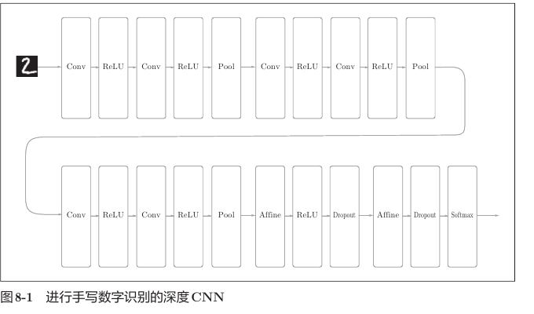

用文字表示为：

```text
Conv → ReLU → Conv → ReLU → Pool
  ↓
Conv → ReLU → Conv → ReLU → Pool
  ↓
Conv → ReLU → Conv → ReLU → Pool
  ↓
Affine → ReLU → Dropout
  ↓
Affine → Dropout → SoftmaxWithLoss
```

它综合使用了前面章节介绍的技术：

| 技术 | 在网络中的作用 |
|---|---|
| `3 × 3` 卷积 | 提取局部空间特征 |
| ReLU | 引入非线性，缓解 Sigmoid 饱和问题 |
| Pooling | 缩小空间尺寸，减少后续计算量 |
| He 初始化 | 使 ReLU 网络中的信号更稳定地传播 |
| Dropout | 减少神经元之间的过度依赖，缓解过拟合 |
| Adam | 自适应调整每个参数的更新幅度 |
| SoftmaxWithLoss | 计算分类概率和交叉熵损失 |

### 2.2 六个卷积层的参数

`DeepConvNet` 的卷积参数为：

```python
conv_param_1 = {'filter_num': 16, 'filter_size': 3, 'pad': 1, 'stride': 1}
conv_param_2 = {'filter_num': 16, 'filter_size': 3, 'pad': 1, 'stride': 1}
conv_param_3 = {'filter_num': 32, 'filter_size': 3, 'pad': 1, 'stride': 1}
conv_param_4 = {'filter_num': 32, 'filter_size': 3, 'pad': 2, 'stride': 1}
conv_param_5 = {'filter_num': 64, 'filter_size': 3, 'pad': 1, 'stride': 1}
conv_param_6 = {'filter_num': 64, 'filter_size': 3, 'pad': 1, 'stride': 1}
```

随着网络加深，空间尺寸逐渐缩小，而通道数逐渐增加：

```text
空间尺寸：28×28 → 14×14 → 8×8 → 4×4
通道数量：  1   →  16   →  32  → 64
```

这种设计可以理解为：

- 浅层保留较大的空间分辨率，提取边缘等基础信息；
- 深层用更多通道表示种类更丰富的特征；
- 池化减少高度和宽度，控制计算量和内存占用。

### 2.3 完整的形状变化

输入一个 mini-batch：

```text
x.shape = (N, 1, 28, 28)
```

网络中每一步的形状如下：

| 层 | 权重形状 | 输出形状 |
|---|---:|---:|
| 输入 | — | `(N, 1, 28, 28)` |
| Conv1，3×3，pad=1 | `(16, 1, 3, 3)` | `(N, 16, 28, 28)` |
| ReLU1 | — | `(N, 16, 28, 28)` |
| Conv2，3×3，pad=1 | `(16, 16, 3, 3)` | `(N, 16, 28, 28)` |
| ReLU2 | — | `(N, 16, 28, 28)` |
| Pool1，2×2，stride=2 | — | `(N, 16, 14, 14)` |
| Conv3，3×3，pad=1 | `(32, 16, 3, 3)` | `(N, 32, 14, 14)` |
| ReLU3 | — | `(N, 32, 14, 14)` |
| Conv4，3×3，pad=2 | `(32, 32, 3, 3)` | `(N, 32, 16, 16)` |
| ReLU4 | — | `(N, 32, 16, 16)` |
| Pool2，2×2，stride=2 | — | `(N, 32, 8, 8)` |
| Conv5，3×3，pad=1 | `(64, 32, 3, 3)` | `(N, 64, 8, 8)` |
| ReLU5 | — | `(N, 64, 8, 8)` |
| Conv6，3×3，pad=1 | `(64, 64, 3, 3)` | `(N, 64, 8, 8)` |
| ReLU6 | — | `(N, 64, 8, 8)` |
| Pool3，2×2，stride=2 | — | `(N, 64, 4, 4)` |
| Flatten | — | `(N, 1024)` |
| Affine1 | `(1024, 50)` | `(N, 50)` |
| ReLU7 | — | `(N, 50)` |
| Dropout1 | — | `(N, 50)` |
| Affine2 | `(50, 10)` | `(N, 10)` |
| Dropout2 | — | `(N, 10)` |
| SoftmaxWithLoss | — | 标量损失 |

其中展平后的节点数为：

$$
64\times4\times4=1024
$$

因此第一层全连接权重为：

```text
W7.shape = (1024, 50)
```

### 2.4 为什么 Conv4 使用 `pad=2`

Conv4 的输入为 `(N, 32, 14, 14)`，滤波器为 `3 × 3`，步幅为1，填充为2：

$$
OH=1+\frac{14+2\times2-3}{1}=16
$$

所以 Conv4 会把空间尺寸从 `14 × 14` 扩大为 `16 × 16`，然后 Pool2 再缩小为 `8 × 8`。

```text
14 × 14 → Conv4(pad=2) → 16 × 16 → Pool2 → 8 × 8
```

这里的 `pad=2` 不是笔误。它是为了让后面的形状最终得到：

```text
64 × 4 × 4
```

不过，这也说明代码中的 `64*4*4` 与当前卷积、池化参数紧密绑定。如果改变输入尺寸或任意一层的 `pad、stride、filter_size`，就必须重新计算全连接层输入大小。

### 2.5 参数形状和数量

| 参数 | 形状 | 参数数量（含偏置） |
|---|---:|---:|
| `W1、b1` | `(16,1,3,3)`、`(16,)` | 160 |
| `W2、b2` | `(16,16,3,3)`、`(16,)` | 2,320 |
| `W3、b3` | `(32,16,3,3)`、`(32,)` | 4,640 |
| `W4、b4` | `(32,32,3,3)`、`(32,)` | 9,248 |
| `W5、b5` | `(64,32,3,3)`、`(64,)` | 18,496 |
| `W6、b6` | `(64,64,3,3)`、`(64,)` | 36,928 |
| `W7、b7` | `(1024,50)`、`(50,)` | 51,250 |
| `W8、b8` | `(50,10)`、`(10,)` | 510 |

总参数数量为：

```text
123,552
```

每个梯度必须与对应参数完全同形：

```text
dW1.shape == W1.shape
db1.shape == b1.shape
...
dW8.shape == W8.shape
db8.shape == b8.shape
```

### 2.6 He 初始化

ReLU 网络推荐使用 He 初始化：

$$
scale=\sqrt{\frac{2}{fan_{in}}}
$$

这里的 `fan_in` 表示一个输出单元连接的输入数量。

卷积层的 `fan_in` 为：

```text
输入通道数 × 滤波器高度 × 滤波器宽度
```

代码中：

```python
pre_node_nums = np.array([
    1*3*3,
    16*3*3,
    16*3*3,
    32*3*3,
    32*3*3,
    64*3*3,
    64*4*4,
    hidden_size
])

weight_init_scales = np.sqrt(2.0 / pre_node_nums)
```

对应关系：

```text
W1：fan_in = 1×3×3 = 9
W2：fan_in = 16×3×3 = 144
W3：fan_in = 16×3×3 = 144
W4：fan_in = 32×3×3 = 288
W5：fan_in = 32×3×3 = 288
W6：fan_in = 64×3×3 = 576
W7：fan_in = 64×4×4 = 1024
W8：fan_in = 50
```

然后将标准正态随机数乘以对应尺度：

```python
W = np.sqrt(2.0 / fan_in) * np.random.randn(...)
```

目的不是让权重越小越好，而是让各层激活值和梯度的尺度较稳定。

### 2.7 使用列表组织网络层

第七章使用 `OrderedDict`，本章使用普通列表：

```python
self.layers = []
self.layers.append(Convolution(...))
self.layers.append(Relu())
...
```

正向传播：

```python
for layer in self.layers:
    x = layer.forward(x)
```

反向传播：

```python
tmp_layers = self.layers.copy()
tmp_layers.reverse()

for layer in tmp_layers:
    dout = layer.backward(dout)
```

先执行 `copy()` 很重要。如果直接对 `self.layers` 调用 `reverse()`，网络原来的正向顺序也会被永久改变。

### 2.8 为什么梯度收集使用层索引

有权重的层在列表中的位置为：

```python
(0, 2, 5, 7, 10, 12, 15, 18)
```

对应：

```text
0   Conv1
2   Conv2
5   Conv3
7   Conv4
10  Conv5
12  Conv6
15  Affine1
18  Affine2
```

所以：

```python
for i, layer_idx in enumerate((0, 2, 5, 7, 10, 12, 15, 18)):
    grads['W' + str(i+1)] = self.layers[layer_idx].dW
    grads['b' + str(i+1)] = self.layers[layer_idx].db
```

`i` 决定参数名 `W1` 到 `W8`，`layer_idx` 决定从哪一个层对象中取梯度。

这种写法简单，但依赖列表位置。如果中间插入或删除一层，就必须同步更新这些索引。

### 2.9 Dropout 的训练模式和推理模式

预测函数专门判断 Dropout：

```python
def predict(self, x, train_flg=False):
    for layer in self.layers:
        if isinstance(layer, Dropout):
            x = layer.forward(x, train_flg)
        else:
            x = layer.forward(x)
    return x
```

训练损失必须启用 Dropout：

```python
y = self.predict(x, train_flg=True)
```

准确率评估必须关闭随机删除：

```python
y = self.predict(tx, train_flg=False)
```

如果评估准确率时仍设置 `train_flg=True`，每次推理都会随机删除不同神经元，结果会随机波动，也不能代表完整网络的推理能力。

### 2.10 训练设置与参数保存

训练脚本使用：

```python
trainer = Trainer(
    network,
    x_train, t_train,
    x_test, t_test,
    epochs=20,
    mini_batch_size=100,
    optimizer='Adam',
    optimizer_param={'lr': 0.001},
    evaluate_sample_num_per_epoch=1000
)
```

`evaluate_sample_num_per_epoch=1000` 只限制每个 epoch 评估准确率时使用的样本数量，不会把训练过程限制为1000个样本。

训练完成后：

```python
network.save_params('deep_convnet_params.pkl')
```

参数文件只保存 `W1～W8、b1～b8`，不保存 Python 类定义。重新读取时仍然要先创建相同结构的 `DeepConvNet`。

---

## 3. 准确率与误分类分析

### 3.1 本项目的实际结果

教材给出的结果约为 `99.38%`，并说明每次训练会存在少量随机差异。

使用本项目当前保存的 `deep_convnet_params.pkl` 在完整的10,000张 MNIST 测试图像上实测：

```text
test accuracy = 0.9935
              = 99.35%
```

这意味着错误样本数量约为：

```text
10,000 × (1 - 0.9935) = 65
```

不同训练得到的准确率可能略有变化，不能要求最后几位数字完全一致。

### 3.2 为什么要观察误分类样本

单个准确率只能告诉我们“总体上对了多少”，却不能解释模型在什么情况下出错。

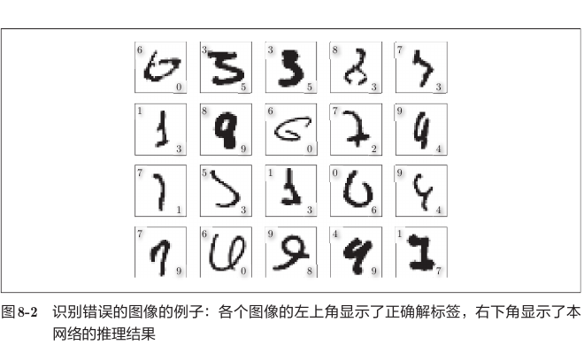

观察误分类样本可以发现：

- 有些数字书写本身就很含糊；
- `1` 与 `7`、`0` 与 `6`、`3` 与 `5` 容易混淆；
- 某些错误对人类而言也很难判断；
- 错误可能来自数据歧义，而不一定只是网络能力不足。

因此，评价模型时不能只看一个数字，还应分析错误类型。

### 3.3 `misclassified_mnist.py` 的数据变化

每次取100张测试图像：

```text
tx      (100, 1, 28, 28)
tt      (100,)
y得分   (100, 10)
预测值   (100,)
```

每批预测被加入列表：

```python
classified_ids.append(y)
```

完整测试集有100批，因此转换为 NumPy 数组后：

```text
classified_ids.shape = (100, 100)
```

再展平：

```python
classified_ids = classified_ids.flatten()
```

```text
classified_ids.shape = (10000,)
t_test.shape         = (10000,)
```

于是可以逐元素比较：

```python
classified_ids == t_test
```

结果是一个长度10,000的布尔数组，`False` 的位置就是误分类样本。

### 3.4 `accuracy()` 的批量注意事项

当前实现只循环：

```python
range(int(x.shape[0] / batch_size))
```

如果样本数量不能被 `batch_size` 整除，最后不足一个批量的样本不会被计算，但最后仍除以全部样本数。

MNIST 测试集10,000张、`batch_size=100` 时可以整除，因此当前实验没有问题。若用于任意规模的数据，更稳妥的写法是：

```python
for i in range(0, x.shape[0], batch_size):
    tx = x[i:i + batch_size]
    tt = t[i:i + batch_size]
```

---

## 4. 进一步提高识别精度

除了加深网络，还可以使用：

- 集成学习；
- 学习率衰减；
- Data Augmentation（数据扩充）；
- 更合理的网络结构和正则化；
- 更多且更有代表性的训练数据。

### 4.1 Data Augmentation

Data Augmentation 对训练图像施加不改变类别含义的变换，从已有数据构造更多训练样本。

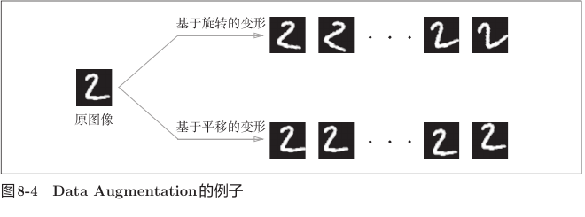

常见图像变换包括：

- 小角度旋转；
- 水平或垂直平移；
- 随机裁剪；
- 缩放；
- 亮度、对比度或颜色变化；
- 在类别语义允许时水平翻转。

它的核心不是简单复制图像，而是向网络表达一种先验：

> 图像发生轻微、合理的变化后，类别通常不应该改变。

例如，数字2平移几个像素后仍然是2。

### 4.2 数据增强不能破坏标签语义

增强方法必须根据具体任务选择：

- 普通物体照片左右翻转通常仍是同一类别；
- 某些文字、交通标志或带方向含义的图像翻转后，语义可能改变；
- 数字 `6` 旋转过大可能接近 `9`；
- 裁剪过多可能把关键目标完全删除。

所以数据增强不是“变化越大、种类越多越好”，而是必须保持标签正确。

---

## 5. 为什么要加深网络

### 5.1 感受野

感受野表示某个神经元的输出会受到输入中多大区域的影响。

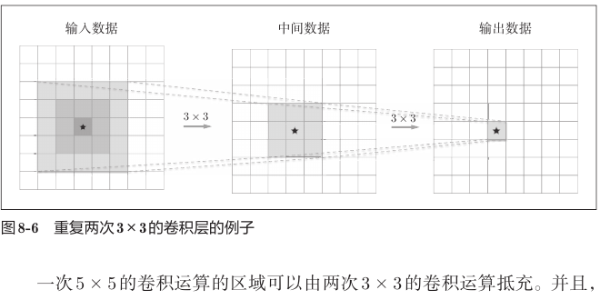

在步幅为1、不考虑边界影响时：

```text
1层 3×3 卷积 → 感受野 3×3
2层 3×3 卷积 → 感受野 5×5
3层 3×3 卷积 → 感受野 7×7
```

对连续的 `k` 层 `3 × 3` 卷积：

$$
R=1+2k
$$

其中 `R` 是感受野边长。

### 5.2 小卷积核为什么更省参数

先忽略通道数，只比较一个空间滤波器：

```text
一次 5×5 卷积：参数数 = 5×5 = 25
两次 3×3 卷积：参数数 = 2×3×3 = 18
```

它们都能得到 `5 × 5` 感受野，但两层 `3 × 3` 参数更少。

再比较：

```text
一次 7×7 卷积：参数数 = 49
三次 3×3 卷积：参数数 = 27
```

实际多通道卷积还要乘输入与输出通道数，不过“小卷积核堆叠可扩大感受野并减少空间核参数”的思想不变。

### 5.3 更多非线性

一次 `5 × 5` 卷积通常只有一次激活：

```text
Conv5×5 → ReLU
```

两次 `3 × 3` 卷积可以插入两次激活：

```text
Conv3×3 → ReLU → Conv3×3 → ReLU
```

如果没有 ReLU 等非线性，多层线性运算仍可以合并为一个线性运算。插入非线性后，网络才能表示更复杂的函数。

### 5.4 分层学习

深层 CNN 可以把复杂任务拆成多个层次：

```text
第1阶段：学习边缘、方向和简单颜色变化
第2阶段：组合成纹理或局部形状
第3阶段：组合成眼睛、轮子等物体部件
第4阶段：根据部件关系判断完整类别
```

每一层只需要在前一层结果的基础上解决更简单的子问题，这比让浅层网络直接从像素一次理解完整物体更容易。

### 5.5 加深并不是没有代价

网络加深后可能出现：

- 梯度消失或梯度爆炸；
- 训练时间变长；
- 中间激活占用更多内存；
- 更容易过拟合；
- 结构和超参数更难调试。

深层网络能够成功训练，依赖于 ReLU、合适初始化、归一化、残差连接、优化器、大规模数据和计算硬件等共同进步。

---

## 6. 经典网络结构

这一节是教材截至当时的历史回顾。重点不是记住竞赛年份和所有层数，而是理解每种网络解决问题的核心思想。

### 6.1 VGG：重复简单模块

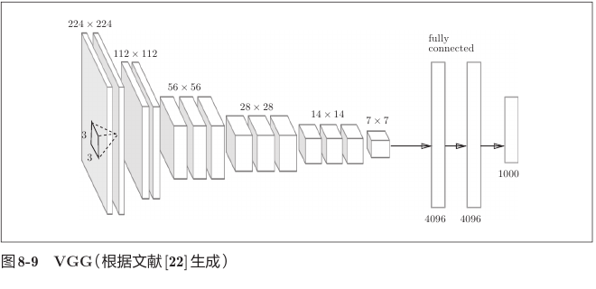

VGG 的特点：

- 主要使用连续的 `3 × 3` 小卷积核；
- 每经过若干卷积后使用池化缩小空间尺寸；
- 随着空间尺寸减小，通道数增加；
- 结构规整、容易理解和迁移。

可以把它概括为：

```text
重复小卷积提取特征 → 池化降采样 → 增加通道 → 最后分类
```

本章 `DeepConvNet` 的设计也参考了这种连续堆叠小型卷积核的思想。

### 6.2 GoogLeNet：Inception 多分支

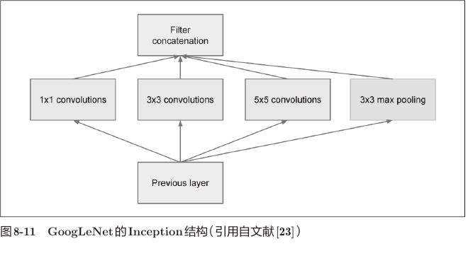

Inception 模块让同一份输入同时经过多个分支：

```text
输入
 ├─ 1×1 Conv
 ├─ 3×3 Conv
 ├─ 5×5 Conv
 └─ 3×3 Pooling
        ↓
在通道轴上合并结果
```

不同尺寸的卷积核观察不同尺度的特征：

- 小卷积核关注细节；
- 大卷积核获得更大的局部感受野；
- 池化提供不同形式的特征汇总。

`1 × 1` 卷积虽然不观察相邻像素，却可以在每个空间位置混合通道信息。它还常用于减少后续卷积的输入通道数，从而降低参数量和计算量。

### 6.3 ResNet：学习残差

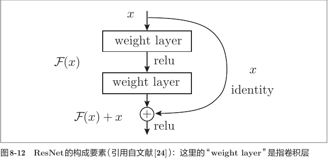

普通两层网络直接学习目标映射，残差块改为学习：

$$
y=F(x)+x
$$

其中：

- `x` 沿快捷连接直接传递；
- `F(x)` 是卷积层需要学习的残差；
- 最后将二者逐元素相加。

反向传播时：

$$
\frac{\partial y}{\partial x}=\frac{\partial F(x)}{\partial x}+1
$$

式子中的 `1` 来自恒等快捷路径。因此，即使卷积分支的梯度很小，仍有一条直接路径把梯度向前传播。

需要注意：`F(x)` 与 `x` 相加时形状必须一致。如果空间尺寸或通道数不同，实际网络通常要对快捷分支进行变换后再相加。

### 6.4 三种网络的核心区别

| 网络 | 核心思想 | 主要价值 |
|---|---|---|
| VGG | 连续堆叠 `3 × 3` 卷积 | 结构规整，用简单模块构建深层网络 |
| GoogLeNet | Inception 多尺度并行分支 | 同时提取不同尺度特征，兼顾深度和宽度 |
| ResNet | `F(x)+x` 快捷连接 | 改善超深网络的优化和梯度传播 |

### 6.5 迁移学习

迁移学习是把在大型数据集上训练好的权重作为新任务的起点：

```text
大型数据集预训练
        ↓
得到通用的边缘、纹理和形状特征
        ↓
复制到新任务
        ↓
冻结一部分层或继续微调
```

它在新任务数据较少时尤其有用，因为不必从随机权重开始重新学习所有基础特征。

---

## 7. 深度学习的高速化

### 7.1 主要瓶颈在卷积层

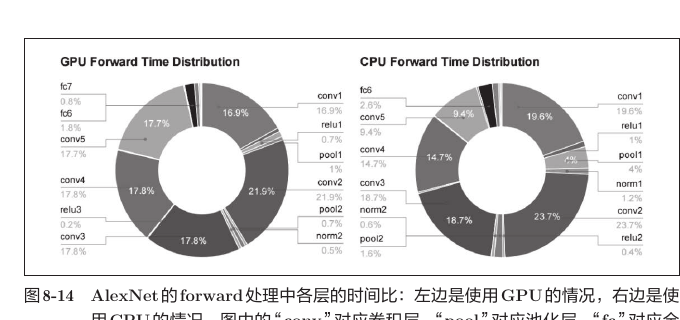

教材中的 AlexNet 实验显示，无论 CPU 还是 GPU，大部分前向计算时间都消耗在卷积层。

卷积本质上包含大量乘积累加：

```text
输入局部区域 × 卷积核 → 求和
```

因此 CNN 高速化的核心问题之一，就是怎样高效完成大量卷积和矩阵乘法。

### 7.2 CPU 与 GPU 的差异

可以粗略理解为：

| CPU | GPU |
|---|---|
| 核心数量较少但单核能力强 | 拥有大量并行计算单元 |
| 擅长复杂控制和串行任务 | 擅长规则的大规模并行数值计算 |
| 通用任务灵活 | 矩阵乘法、卷积等吞吐量高 |

深度学习中大量元素可以同时进行相同类型的乘积累加，所以很适合 GPU。

第七章的 `im2col` 把卷积整理成大型矩阵乘法，也是在把零散卷积计算变成更适合高性能计算库处理的形式。

### 7.3 CUDA 与 cuDNN

- CUDA 是 NVIDIA 提供的 GPU 通用计算平台；
- cuDNN 是针对深度神经网络常见运算优化的库；
- 深度学习框架通常调用这些底层库，而不是让用户自己编写 GPU 卷积内核。

硬件只提供计算能力，高效算法和优化库决定能否真正发挥这种能力。

### 7.4 分布式学习

当一块 GPU 仍然不够快时，可以把训练分配到多块 GPU 或多台机器。

```text
数据或模型被分配到多个计算设备
             ↓
各设备完成部分计算
             ↓
通信并汇总梯度或参数
             ↓
继续下一次更新
```

设备数量增加并不意味着速度严格按相同比例增加，因为还存在：

- 设备间通信；
- 参数和梯度同步；
- 数据读取；
- 任务负载不均衡；
- 框架调度开销。

所以分布式训练需要在计算收益与通信成本之间取得平衡。

### 7.5 降低数值精度

浮点数位数越少，通常意味着：

- 单个数占用的存储空间更小；
- 内存和总线可以一次传输更多数据；
- 支持低精度运算的硬件可以获得更高吞吐量；
- 但可表示范围和数值精度也会降低。

本项目 `half_float_network.py` 比较了当前参数在两种情况下的推理结果：

```text
原参数值：                 accuracy = 0.9935
量化到 float16 精度后的值：accuracy = 0.9935
```

这个结果说明当前模型对这种程度的数值误差较鲁棒，但不表示所有模型、训练过程和硬件上都一定完全没有影响。

### 7.6 当前半精度代码的重要细节

代码写法：

```python
for param in network.params.values():
    param[...] = param.astype(np.float16)
```

右侧先得到 `float16` 数值，但左侧 `param[...]` 是对原数组原地赋值。原数组的类型是 `float64`，赋值时这些数会再次存入 `float64` 数组。

本项目实测：

```text
转换前 dtype：float64
转换后 dtype：float64
```

所以当前代码的真实效果是：

```text
把参数值舍入到 float16 能表示的精度
但仍保存在 float64 数组中
```

它可以验证低精度数值对准确率的影响，但不会真正减少参数数组的内存占用，也不等同于硬件上的真正半精度计算。

---

## 8. 深度学习的应用

### 8.1 分类、检测和分割的区别

```text
图像分类：整张图像是什么？
物体检测：图中有哪些物体？它们在哪里？
图像分割：每一个像素属于什么类别？
```

| 任务 | 典型输出 |
|---|---|
| 分类 | 一个类别或类别概率 `(N, K)` |
| 检测 | 多个边界框、类别和置信度 |
| 分割 | 与图像空间对应的逐像素类别图 |

### 8.2 物体检测与 R-CNN

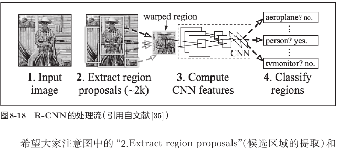

教材中的 R-CNN 基本流程：

```text
输入图像
  ↓
提取可能包含物体的候选区域
  ↓
把候选区域调整为统一大小
  ↓
用 CNN 提取每个区域的特征
  ↓
判断每个区域的类别
```

物体检测比单纯分类更难，因为：

- 一张图中可能有多个物体；
- 物体位置、尺寸和比例不同；
- 网络不仅要分类，还要定位。

教材介绍的 R-CNN 是理解检测任务发展的历史示例。复习时重点掌握“候选区域 + CNN 特征 + 分类”的总体思想。

### 8.3 图像分割与 FCN

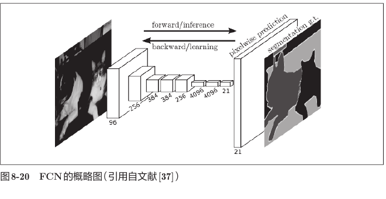

若为每个像素单独截取区域并执行一次网络，会产生大量重复计算。FCN（Fully Convolutional Network）用一次前向传播同时预测全部像素。

FCN 的核心：

- 将全连接层替换为卷积层；
- 在网络内部保留空间排列；
- 末端把低分辨率特征图上采样回输入大小；
- 输出每个像素的类别。

全连接层也可以表示成卷积层。例如，输入为 `(32, 10, 10)`，全连接层有100个输出节点，那么可用100个 `(32, 10, 10)` 卷积核实现等价连接。

### 8.4 图像标题生成

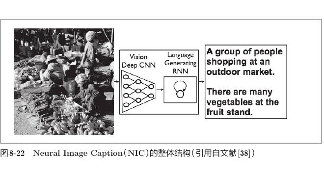

图像标题生成把计算机视觉和自然语言处理结合起来：

```text
图像
 ↓
CNN 提取视觉特征
 ↓
RNN 根据视觉特征逐词生成句子
 ↓
图像描述文本
```

CNN 负责“看懂”图像，RNN 负责根据已经生成的内容继续生成后续词语。这种同时处理图像与语言的信息处理称为多模态处理。

### 8.5 图像生成与 GAN

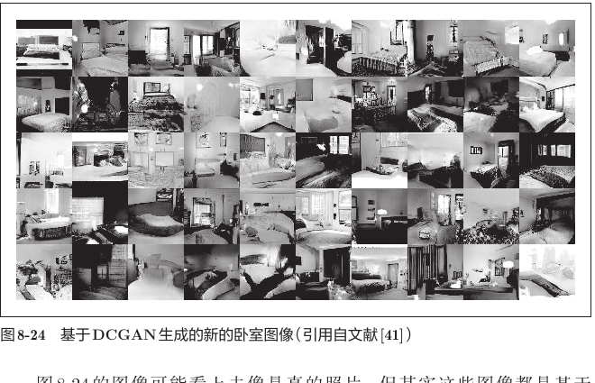

GAN 包含两个相互竞争的网络：

```text
Generator（生成器）
输入随机信息 → 生成尽量逼真的假图像

Discriminator（判别器）
输入图像 → 判断它来自真实数据还是生成器
```

训练过程可以理解为：

```text
生成器不断提高“造假”能力
             ↕ 竞争
判别器不断提高“鉴别”能力
```

最终希望生成器学习到训练数据的分布，并生成训练集中从未出现过的新样本。

### 8.6 自动驾驶中的环境理解

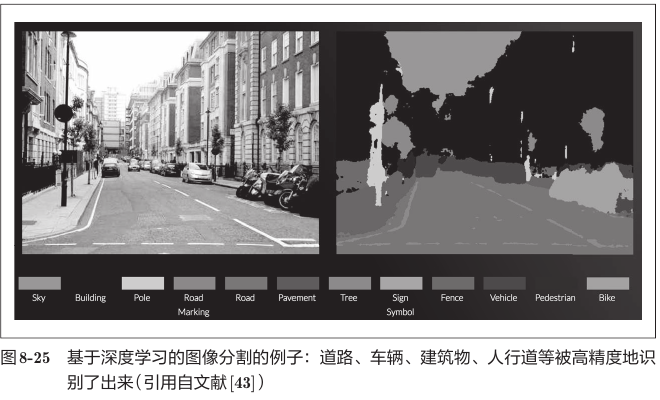

自动驾驶系统需要理解：

- 道路和车道；
- 车辆；
- 行人；
- 建筑物和路边环境；
- 可行驶区域与障碍物。

语义分割为每个像素赋予类别，可以为环境理解提供精细的空间信息。但真正的自动驾驶还需要传感器融合、目标跟踪、定位、路径规划与安全控制等多个系统共同工作。

### 8.7 DQN 与强化学习

强化学习的基本参与者：

```text
Agent（代理）观察环境状态
        ↓
选择 Action（行动）
        ↓
环境发生变化
        ↓
获得 Reward（奖励）和新状态
        ↓
学习怎样获得更大的长期累计奖励
```

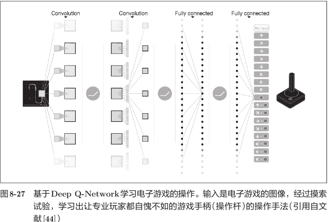

DQN 使用 CNN 从连续游戏画面中提取状态特征，然后为各个可能动作输出价值。

```text
连续4帧游戏画面
        ↓
卷积层提取视觉状态
        ↓
全连接层
        ↓
每个可选动作的价值
        ↓
选择行动
```

监督学习直接提供正确标签；强化学习通常只得到奖励信号，需要通过探索和长期结果学习行动策略。

---

## 9. 本章代码与复习目标

| 文件 | 主要内容 | 复习时重点观察 |
|---|---|---|
| `deep_convnet.py` | 定义八个有权重层的 DeepConvNet | 各层形状、He 初始化、Dropout 模式和反向传播 |
| `train_deepnet.py` | 使用 Adam 训练 MNIST | Trainer 参数、训练轮数和参数保存 |
| `misclassified_mnist.py` | 查找并显示误分类图像 | 批量预测、展平结果和布尔比较 |
| `half_float_network.py` | 比较低精度参数的推理准确率 | 数值量化、数组 dtype 与准确率的区别 |
| `deep_convnet_params.pkl` | 已训练的网络参数 | 载入后必须同步更新层对象中的权重引用 |

---

## 10. 常见易错点

1. **认为深度学习等于简单增加层数。** 深层网络还需要初始化、激活函数、优化器、正则化和足够数据共同支持。
2. **把所有卷积层都理解成保持空间尺寸。** Conv4 使用 `pad=2`，会把 `14 × 14` 扩大为 `16 × 16`。
3. **把 `64*4*4` 当成永远正确。** 它只适用于当前输入和卷积、池化参数。
4. **卷积权重第二维仍写成原始图像通道1。** 后续卷积的输入通道必须等于上一卷积层的输出通道。
5. **He 初始化只除以通道数。** 卷积层 `fan_in` 是 `C × FH × FW`。
6. **把 He 初始化写成 `sqrt(1/fan_in)`。** ReLU 对应的是 `sqrt(2/fan_in)`；前者更接近 Xavier 的尺度。
7. **直接反转 `self.layers`。** 应反转副本，否则下一次正向传播顺序会被破坏。
8. **插入新层后忘记修改梯度层索引。** `(0,2,5,7,10,12,15,18)` 依赖当前列表结构。
9. **训练时关闭 Dropout。** `loss()` 应调用 `predict(..., train_flg=True)`。
10. **测试时仍随机执行 Dropout。** 准确率计算应使用 `train_flg=False`。
11. **载入参数后只更新 `self.params`。** 层对象内部的 `W、b` 也必须指向新参数。
12. **误以为准确率高就没有必要分析错误。** 误分类样本能揭示数据歧义和系统性弱点。
13. **样本数不能整除批量大小时仍使用当前 `accuracy()`。** 当前实现会遗漏最后不足一个批量的样本。
14. **对任意图像增强都保留原标签。** 翻转、旋转或裁剪可能改变某些任务的语义。
15. **只比较滤波器边长，忽略通道数。** 实际卷积参数量还与输入、输出通道数有关。
16. **认为感受野增大就一定提高性能。** 表现还取决于特征表达、优化难度、数据和正则化。
17. **认为 ResNet 的相加不需要检查形状。** `F(x)` 与 `x` 必须形状一致，或先变换快捷分支。
18. **认为 GPU 对任何程序都同样快。** GPU 更适合大规模规则并行计算，数据搬运和小任务可能抵消收益。
19. **认为增加100倍 GPU 就必然加速100倍。** 分布式学习受到通信、同步和负载均衡开销限制。
20. **把 `param[...] = param.astype(np.float16)` 当成真正改变数组类型。** 当前写法只量化数值，原数组仍是 `float64`。
21. **从参数量较少推断运行一定快。** 运行时间还受特征图尺寸、乘积累加次数、内存访问和硬件实现影响。
22. **混淆分类、检测和分割。** 三者输出目标和监督数据形式不同。
23. **把生成模型理解成复制训练图片。** 目标是学习数据分布并产生新样本，而不是简单查表。
24. **把强化学习的奖励当成每一步的正确标签。** 奖励通常稀疏、延迟，并不直接告诉代理正确动作。

---

## 11. 复习速记

```text
DeepConvNet：
Conv-ReLU-Conv-ReLU-Pool × 3
→ Affine-ReLU-Dropout
→ Affine-Dropout-SoftmaxWithLoss

通道：1 → 16 → 16 → 32 → 32 → 64 → 64
空间：28 → 28 → 14 → 14 → 16 → 8 → 8 → 4
展平：64×4×4 = 1024

训练组合：
ReLU + He 初始化 + Adam + Dropout

加深网络：
小卷积核堆叠 → 更大感受野
              → 更少空间核参数
              → 更多非线性
              → 分层提取特征

经典网络：
VGG：       连续 3×3 卷积
GoogLeNet： Inception 多分支、多尺度
ResNet：    F(x) + x 快捷连接

高速化：
卷积是主要计算瓶颈
GPU 适合大规模并行乘积累加
分布式训练需要考虑通信和同步
低精度可降低存储与带宽压力

应用：
分类：整张图是什么
检测：物体是什么、在哪里
分割：每个像素是什么
NIC：CNN + RNN 生成图像标题
GAN：生成器与判别器竞争
DQN：CNN 估计动作价值
```

## 12. 自我检查

复习后，应能够回答下面的问题：

1. DeepConvNet 组合了前面章节中的哪些技术？
2. 六个卷积层的通道数怎样变化？
3. 为什么 Conv4 会把 `14 × 14` 变成 `16 × 16`？
4. `W1～W8` 分别是什么形状？
5. `64 × 4 × 4 = 1024` 是怎样得到的？
6. 卷积层的 `fan_in` 为什么是 `C × FH × FW`？
7. 为什么反向传播要反转层列表的副本？
8. 为什么 Dropout 必须区分训练和推理模式？
9. 误分类样本分析能提供哪些准确率没有提供的信息？
10. 两层 `3 × 3` 卷积为什么具有 `5 × 5` 感受野？
11. 堆叠小卷积核相比单个大卷积核有什么好处？
12. VGG、GoogLeNet 和 ResNet 的核心思想分别是什么？
13. 为什么快捷连接有助于梯度传播？
14. 为什么 CNN 中卷积层通常是主要计算瓶颈？
15. GPU 为什么适合深度学习计算？
16. 分布式训练为什么不能获得完全线性的加速？
17. 当前半精度脚本是否真正把参数数组改成了 `float16`？
18. 图像分类、物体检测和图像分割有什么区别？
19. 图像标题生成中 CNN 和 RNN 分别负责什么？
20. GAN 中生成器和判别器怎样相互促进？
21. 监督学习的标签与强化学习的奖励有什么区别？

## 13. 本章一句话总结

> 深度学习的力量不仅来自“层数更多”，而来自小卷积核与层次化表示、正确的训练技术、高效计算和残差等结构创新的共同作用；这些能力又让神经网络从图像分类扩展到检测、分割、生成、多模态理解和强化学习。

---

文中教材插图来自本仓库 `docs` 目录下的《深度学习入门：基于Python的理论与实现》PDF，仅用于个人学习与复习。
